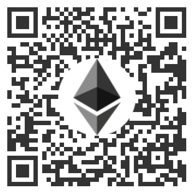
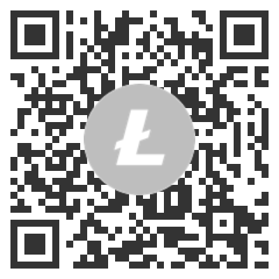

# Cryptocurrency Icons

PNG cryptocurrency icons in 16, 32, 64, and 128 px sizes. The collection includes icons sourced from CoinMarketCap.

## Quick start

Copy this HTML to display the 32 px Bitcoin icon:

```html

```

## Preview


## Donations
**This is all voluntary work**, so if you want to support my efforts [please donate](https://erikthiart.com/donate-or-buy-me-coffee.php). 

Donation addresses are found below (if you don't see your coin, let me know and I'll send the address afterwards) alternatively you can use paypal too [paypal.me/erikthiart](https://paypal.me/erikthiart)

Bitcoin Address QR Code            |  Ethereum Address QR Code         |  Litecoin Address QR Code
:-------------------------:|:-------------------------:|:-------------------------:
  |   | 

**BTC**: 1GeXS8t5KtYvyMAf5hhwtdxM9Ba9EWQqMz

**ETH**: 0x023f29596Bf80c521C906f80ee305fADc3B1Be3C

**LTC**: LcNa8XKqimLjXDGck7dPnxEjENPm9t6r3H

## List of all the coin icons

* [bitcoin.png](16/bitcoin.png "Bitcoin (BTC)") ")
* [ethereum.png](16/ethereum.png "Ethereum (ETH)") ")
* [tether.png](16/tether.png "Tether (USDT)") ")
* [polkadot-new.png](16/polkadot-new.png "Polkadot (DOT)") ")
* [xrp.png](16/xrp.png "XRP (XRP)") ")
* [cardano.png](16/cardano.png "Cardano (ADA)") ")
* [litecoin.png](16/litecoin.png "Litecoin (LTC)") ")
* [bitcoin-cash.png](16/bitcoin-cash.png "Bitcoin Cash (BCH)") ")
* [chainlink.png](16/chainlink.png "Chainlink (LINK)") ")
* [stellar.png](16/stellar.png "Stellar (XLM)") ")
* [binance-coin.png](16/binance-coin.png "Binance Coin (BNB)") ")
* [usd-coin.png](16/usd-coin.png "USD Coin (USDC)") ")
* [wrapped-bitcoin.png](16/wrapped-bitcoin.png "Wrapped Bitcoin (WBTC)") ")
* [bitcoin-sv.png](16/bitcoin-sv.png "Bitcoin SV (BSV)") ")
* [monero.png](16/monero.png "Monero (XMR)") ")
* [eos.png](16/eos.png "EOS (EOS)") ")
* [uniswap.png](16/uniswap.png "Uniswap (UNI)") ")
* [aave.png](16/aave.png "Aave (AAVE)") ")
* [tron.png](16/tron.png "TRON (TRX)") ")
* [tezos.png](16/tezos.png "Tezos (XTZ)") ")
* [nem.png](16/nem.png "NEM (XEM)") ")
* [theta.png](16/theta.png "THETA (THETA)") ")
* [cosmos.png](16/cosmos.png "Cosmos (ATOM)") ")
* [internet-computer.png](16/internet-computer.png "Internet Computer (ICP)") ")
* [vechain.png](16/vechain.png "VeChain (VET)") ")
* [crypto-com-coin.png](16/crypto-com-coin.png "Crypto.com Coin (CRO)") ")
* [neo.png](16/neo.png "Neo (NEO)") ")
* [synthetix-network-token.png](16/synthetix-network-token.png "Synthetix (SNX)") ")
* [maker.png](16/maker.png "Maker (MKR)") ")
* [multi-collateral-dai.png](16/multi-collateral-dai.png "Dai (DAI)") ")
* [unus-sed-leo.png](16/unus-sed-leo.png "UNUS SED LEO (LEO)") ")
* [dash.png](16/dash.png "Dash (DASH)") ")
* [iota.png](16/iota.png "IOTA (MIOTA)") ")
* [dogecoin.png](16/dogecoin.png "Dogecoin (DOGE)") ")
* [huobi-token.png](16/huobi-token.png "Huobi Token (HT)") ")
* [binance-usd.png](16/binance-usd.png "Binance USD (BUSD)") ")
* [celsius.png](16/celsius.png "Celsius (CEL)") ")
* [zcash.png](16/zcash.png "Zcash (ZEC)") ")
* [yearn-finance.png](16/yearn-finance.png "yearn.finance (YFI)") ")
* [filecoin.png](16/filecoin.png "Filecoin (FIL)") ")
* [ftx-token.png](16/ftx-token.png "FTX Token (FTT)") ")
* [compound.png](16/compound.png "Compound (COMP)") ")
* [solana.png](16/solana.png "Solana (SOL)") ")
* [avalanche.png](16/avalanche.png "Avalanche (AVAX)") ")
* [revain.png](16/revain.png "Revain (REV)") ")
* [ethereum-classic.png](16/ethereum-classic.png "Ethereum Classic (ETC)") ")
* [sushiswap.png](16/sushiswap.png "SushiSwap (SUSHI)") ")
* [kusama.png](16/kusama.png "Kusama (KSM)") ")
* [zilliqa.png](16/zilliqa.png "Zilliqa (ZIL)") ")
* [waves.png](16/waves.png "Waves (WAVES)") ")
* [uma.png](16/uma.png "UMA (UMA)") ")
* [decred.png](16/decred.png "Decred (DCR)") ")
* [algorand.png](16/algorand.png "Algorand (ALGO)") ")
* [the-graph.png](16/the-graph.png "The Graph (GRT)") ")
* [elrond-egld.png](16/elrond-egld.png "Elrond (EGLD)") ")
* [hedgetrade.png](16/hedgetrade.png "HedgeTrade (HEDG)") ")
* [omg.png](16/omg.png "OMG Network (OMG)") ")
* [ontology.png](16/ontology.png "Ontology (ONT)") ")
* [loopring.png](16/loopring.png "Loopring (LRC)") ")
* [ren.png](16/ren.png "Ren (REN)") ")
* [renbtc.png](16/renbtc.png "renBTC (RENBTC)") ")
* [nano.png](16/nano.png "Nano (NANO)") ")
* [near-protocol.png](16/near-protocol.png "NEAR Protocol (NEAR)") ")
* [terra-luna.png](16/terra-luna.png "Terra (LUNA)") ")
* [icon.png](16/icon.png "ICON (ICX)") ")
* [reserve-rights.png](16/reserve-rights.png "Reserve Rights (RSR)") ")
* [0x.png](16/0x.png "0x (ZRX)") ")
* [hedera-hashgraph.png](16/hedera-hashgraph.png "Hedera Hashgraph (HBAR)") ")
* [basic-attention-token.png](16/basic-attention-token.png "Basic Attention Token (BAT)") ")
* [trueusd.png](16/trueusd.png "TrueUSD (TUSD)") ")
* [digibyte.png](16/digibyte.png "DigiByte (DGB)") ")
* [okb.png](16/okb.png "OKB (OKB)") ")
* [bittorrent.png](16/bittorrent.png "BitTorrent (BTT)") ")
* [nexo.png](16/nexo.png "Nexo (NEXO)") ")
* [blockstack.png](16/blockstack.png "Blockstack (STX)") ")
* [thorchain.png](16/thorchain.png "THORChain (RUNE)") ")
* [qtum.png](16/qtum.png "Qtum (QTUM)") ")
* [mdex.png](16/mdex.png "Mdex (MDX)") ")
* [iostoken.png](16/iostoken.png "IOST (IOST)") ")
* [horizen.png](16/horizen.png "Horizen (ZEN)") ")
* [energy-web-token.png](16/energy-web-token.png "Energy Web Token (EWT)") ")
* [husd.png](16/husd.png "HUSD (HUSD)") ")
* [curve-dao-token.png](16/curve-dao-token.png "Curve DAO Token (CRV)") ")
* [swissborg.png](16/swissborg.png "SwissBorg (CHSB)") ")
* [celo.png](16/celo.png "Celo (CELO)") ")
* [kyber-network.png](16/kyber-network.png "Kyber Network (KNC)") ")
* [bitcoin-bep2.png](16/bitcoin-bep2.png "Bitcoin BEP2 (BTCB)") ")
* [voyager-token.png](16/voyager-token.png "Voyager Token (VGX)") ")
* [paxos-standard.png](16/paxos-standard.png "Paxos Standard (PAX)") ")
* [enjin-coin.png](16/enjin-coin.png "Enjin Coin (ENJ)") ")
* [quant.png](16/quant.png "Quant (QNT)") ")
* [ampleforth.png](16/ampleforth.png "Ampleforth (AMPL)") ")
* [ocean-protocol.png](16/ocean-protocol.png "Ocean Protocol (OCEAN)") ")
* [siacoin.png](16/siacoin.png "Siacoin (SC)") ")
* [bitcoin-gold.png](16/bitcoin-gold.png "Bitcoin Gold (BTG)") ")
* [augur.png](16/augur.png "Augur (REP)") ")
* [verge.png](16/verge.png "Verge (XVG)") ")
* [band-protocol.png](16/band-protocol.png "Band Protocol (BAND)") ")
* [nxm.png](16/nxm.png "NXM (NXM)") ")
* [status.png](16/status.png "Status (SNT)") ")
* [terrausd.png](16/terrausd.png "TerraUSD (UST)") ")
* [abbc-coin.png](16/abbc-coin.png "ABBC Coin (ABBC)") ")
* [bancor.png](16/bancor.png "Bancor (BNT)") ")
* [gnosis-gno.png](16/gnosis-gno.png "Gnosis (GNO)") ")
* [decentraland.png](16/decentraland.png "Decentraland (MANA)") ")
* [lisk.png](16/lisk.png "Lisk (LSK)") ")
* [matic-network.png](16/matic-network.png "Matic Network (MATIC)") ")
* [balancer.png](16/balancer.png "Balancer (BAL)") ")
* [aragon.png](16/aragon.png "Aragon (ANT)") ")
* [arweave.png](16/arweave.png "Arweave (AR)") ")
* [ravencoin.png](16/ravencoin.png "Ravencoin (RVN)") ")
* [1inch.png](16/1inch.png "1inch (1INCH)") ")
* [flow.png](16/flow.png "Flow (FLOW)") ")
* [theta-fuel.png](16/theta-fuel.png "Theta Fuel (TFUEL)") ")
* [bitcoin-diamond.png](16/bitcoin-diamond.png "Bitcoin Diamond (BCD)") ")
* [injective-protocol.png](16/injective-protocol.png "Injective Protocol (INJ)") ")
* [zb-token.png](16/zb-token.png "ZB Token (ZB)") ")
* [maidsafecoin.png](16/maidsafecoin.png "MaidSafeCoin (MAID)") ")
* [rsk-infrastructure-framework.png](16/rsk-infrastructure-framework.png "RSK Infrastructure Framework (RIF)") ")
* [numeraire.png](16/numeraire.png "Numeraire (NMR)") ")
* [funfair.png](16/funfair.png "FunFair (FUN)") ")
* [holo.png](16/holo.png "Holo (HOT)") ")
* [nervos-network.png](16/nervos-network.png "Nervos Network (CKB)") ")
* [helium.png](16/helium.png "Helium (HNT)") ")
* [orchid.png](16/orchid.png "Orchid (OXT)") ")
* [chiliz.png](16/chiliz.png "Chiliz (CHZ)") ")
* [monacoin.png](16/monacoin.png "MonaCoin (MONA)") ")
* [civic.png](16/civic.png "Civic (CVC)") ")
* [mina.png](16/mina.png "Mina (MINA)") ")
* [alpha-finance-lab.png](16/alpha-finance-lab.png "Alpha Finance Lab (ALPHA)") ")
* [cybervein.png](16/cybervein.png "CyberVein (CVT)") ")
* [tomochain.png](16/tomochain.png "TomoChain (TOMO)") ")
* [utrust.png](16/utrust.png "Utrust (UTK)") ")
* [unibright.png](16/unibright.png "Unibright (UBT)") ")
* [pax-gold.png](16/pax-gold.png "PAX Gold (PAXG)") ")
* [bytom.png](16/bytom.png "Bytom (BTM)") ")
* [kava.png](16/kava.png "Kava.io (KAVA)") ")
* [rlc.png](16/rlc.png "iExec RLC (RLC)") ")
* [serum.png](16/serum.png "Serum (SRM)") ")
* [kucoin-token.png](16/kucoin-token.png "KuCoin Token (KCS)") ")
* [oasis-network.png](16/oasis-network.png "Oasis Network (ROSE)") ")
* [storj.png](16/storj.png "Storj (STORJ)") ")
* [swipe.png](16/swipe.png "Swipe (SXP)") ")
* [pundi-x.png](16/pundi-x.png "Pundi X (NPXS)") ")
* [iotex.png](16/iotex.png "IoTeX (IOTX)") ")
* [secret.png](16/secret.png "Secret (SCRT)") ")
* [ardor.png](16/ardor.png "Ardor (ARDR)") ")
* [aelf.png](16/aelf.png "aelf (ELF)") ")
* [yearn-finance-ii.png](16/yearn-finance-ii.png "DFI.Money (YFII)") ")
* [kleros.png](16/kleros.png "Kleros (PNK)") ")
* [golem-network-tokens.png](16/golem-network-tokens.png "Golem (GLM)") ")
* [steem.png](16/steem.png "Steem (STEEM)") ")
* [bitshares.png](16/bitshares.png "BitShares (BTS)") ")
* [komodo.png](16/komodo.png "Komodo (KMD)") ")
* [xdai.png](16/xdai.png "xDai (STAKE)") ")
* [velas.png](16/velas.png "Velas (VLX)") ")
* [fantom.png](16/fantom.png "Fantom (FTM)") ")
* [btc-standard-hashrate-token.png](16/btc-standard-hashrate-token.png "Bitcoin Standard Hashrate Token (BTCST)") ")
* [keep3rv1.png](16/keep3rv1.png "Keep3rV1 (KP3R)") ")
* [lto-network.png](16/lto-network.png "LTO Network (LTO)") ")
* [dxchain-token.png](16/dxchain-token.png "DxChain Token (DX)") ")
* [district0x.png](16/district0x.png "district0x (DNT)") ")
* [syntropy.png](16/syntropy.png "Syntropy (NOIA)") ")
* [library-credit.png](16/library-credit.png "LBRY Credits (LBC)") ")
* [travala.png](16/travala.png "Travala.com (AVA)") ")
* [fetch.png](16/fetch.png "Fetch.ai (FET)") ")
* [wanchain.png](16/wanchain.png "Wanchain (WAN)") ")
* [just.png](16/just.png "JUST (JST)") ")
* [harmony.png](16/harmony.png "Harmony (ONE)") ")
* [firo.png](16/firo.png "Firo (FIRO)") ")
* [singularitynet.png](16/singularitynet.png "SingularityNET (AGI)") ")
* [kin.png](16/kin.png "Kin (KIN)") ")
* [wax.png](16/wax.png "WAX (WAXP)") ")
* [melon.png](16/melon.png "Melon (MLN)") ")
* [origintrail.png](16/origintrail.png "OriginTrail (TRAC)") ")
* [ankr.png](16/ankr.png "Ankr (ANKR)") ")
* [electroneum.png](16/electroneum.png "Electroneum (ETN)") ")
* [irisnet.png](16/irisnet.png "IRISnet (IRIS)") ")
* [loom-network.png](16/loom-network.png "Loom Network (LOOM)") ")
* [stratis.png](16/stratis.png "Stratis (STRAX)") ")
* [energi.png](16/energi.png "Energi (NRG)") ")
* [polymath-network.png](16/polymath-network.png "Polymath (POLY)") ")
* [aidos-kuneen.png](16/aidos-kuneen.png "Aidos Kuneen (ADK)") ")
* [hive-blockchain.png](16/hive-blockchain.png "Hive (HIVE)") ")
* [trustswap.png](16/trustswap.png "TrustSwap (SWAP)") ")
* [waykichain.png](16/waykichain.png "WaykiChain (WICC)") ")
* [casper.png](16/casper.png "Casper (CSPR)") ")
* [ark.png](16/ark.png "Ark (ARK)") ")
* [divi.png](16/divi.png "Divi (DIVI)") ")
* [syscoin.png](16/syscoin.png "Syscoin (SYS)") ")
* [tellor.png](16/tellor.png "Tellor (TRB)") ")
* [handshake.png](16/handshake.png "Handshake (HNS)") ")
* [uquid-coin.png](16/uquid-coin.png "Uquid Coin (UQC)") ")
* [vethor-token.png](16/vethor-token.png "VeThor Token (VTHO)") ")
* [power-ledger.png](16/power-ledger.png "Power Ledger (POWR)") ")
* [populous.png](16/populous.png "Populous (PPT)") ")
* [strike.png](16/strike.png "Strike (STRK)") ")
* [mainframe.png](16/mainframe.png "Mainframe (MFT)") ")
* [dia.png](16/dia.png "DIA (DIA)") ")
* [telcoin.png](16/telcoin.png "Telcoin (TEL)") ")
* [adx-net.png](16/adx-net.png "AdEx Network (ADX)") ")
* [aion.png](16/aion.png "Aion (AION)") ")
* [elastos.png](16/elastos.png "Elastos (ELA)") ")
* [crypto-com.png](16/crypto-com.png "MCO (MCO)") ")
* [nimiq.png](16/nimiq.png "Nimiq (NIM)") ")
* [bzx-protocol.png](16/bzx-protocol.png "bZx Protocol (BZRX)") ")
* [akropolis.png](16/akropolis.png "Akropolis (AKRO)") ")
* [hex.png](16/hex.png "HEX (HEX)") ")
* [counos-x.png](16/counos-x.png "Counos X (CCXX)") ")
* [ino-coin.png](16/ino-coin.png "INO COIN (INO)") ")
* [fei-protocol.png](16/fei-protocol.png "Fei Protocol (FEI)") ")
* [ize.png](16/ize.png "IZE (IZE)") ")
* [defichain.png](16/defichain.png "DeFiChain (DFI)") ")
* [safemoon.png](16/safemoon.png "SafeMoon (SAFEMOON)") ")
* [thorecoin.png](16/thorecoin.png "ThoreCoin (THR)") ")
* [insight-chain.png](16/insight-chain.png "Insight Chain (INB)") ")
* [creditcoin.png](16/creditcoin.png "Creditcoin (CTC)") ")
* [basid-coin.png](16/basid-coin.png "Basid Coin (BASID)") ")
* [botxcoin.png](16/botxcoin.png "botXcoin (BOTX)") ")
* [bitcoin-cash-abc-2.png](16/bitcoin-cash-abc-2.png "Bitcoin Cash ABC (BCHA)") ")
* [zelwin.png](16/zelwin.png "Zelwin (ZLW)") ")
* [cipher-core-token.png](16/cipher-core-token.png "Cipher Core Token (CIPHC)") ")
* [liquity-usd.png](16/liquity-usd.png "Liquity USD (LUSD)") ")
* [stpay.png](16/stpay.png "STPAY (STP)") ")
* [symbol.png](16/symbol.png "Symbol (XYM)") ")
* [cryptonex.png](16/cryptonex.png "Cryptonex (CNX)") ")
* [empty-set-dollar.png](16/empty-set-dollar.png "Empty Set Dollar (ESD)") ")
* [helper-search-token.png](16/helper-search-token.png "Helper Search Token (HSN)") ")
* [huobi-btc.png](16/huobi-btc.png "Huobi BTC (HBTC)") ")
* [largo-coin.png](16/largo-coin.png "Largo Coin (LRG)") ")
* [sologenic.png](16/sologenic.png "Sologenic (SOLO)") ")
* [elitium.png](16/elitium.png "Elitium (EUM)") ")
* [chimpion.png](16/chimpion.png "Chimpion (BNANA)") ")
* [yusra.png](16/yusra.png "YUSRA (YUSRA)") ")
* [metacoin.png](16/metacoin.png "Metacoin (MTC)") ")
* [doctors-coin.png](16/doctors-coin.png "Doctors Coin (DRS)") ")
* [ecomi.png](16/ecomi.png "ECOMI (OMI)") ")
* [vitae.png](16/vitae.png "Vitae (VITAE)") ")
* [parsiq.png](16/parsiq.png "PARSIQ (PRQ)") ")
* [bridge-oracle.png](16/bridge-oracle.png "Bridge Oracle (BRG)") ")
* [keep-network.png](16/keep-network.png "Keep Network (KEEP)") ")
* [persistence.png](16/persistence.png "Persistence (XPRT)") ")
* [susd.png](16/susd.png "sUSD (SUSD)") ")
* [newyork-exchange.png](16/newyork-exchange.png "NewYork Exchange (NYE)") ")
* [bitpanda-ecosystem-token.png](16/bitpanda-ecosystem-token.png "Bitpanda Ecosystem Token (BEST)") ")
* [mobilian-coin.png](16/mobilian-coin.png "Mobilian Coin (MBN)") ")
* [anchor-protocol.png](16/anchor-protocol.png "Anchor Protocol (ANC)") ")
* [pundix-new.png](16/pundix-new.png "Pundi X[new] (PUNDIX)") ![Pundi X[new]](https://raw.githubusercontent.com/ErikThiart/cryptocurrency-icons/master/16/pundix-new.png "Pundi X[new] (PUNDIX)")
* [tratin.png](16/tratin.png "Tratin (TRAT)") ")
* [idea-chain-coin.png](16/idea-chain-coin.png "Idea Chain Coin (ICH)") ")
* [cryptobucks.png](16/cryptobucks.png "CRYPTOBUCKS (CBUCKS)") ")
* [darma-cash.png](16/darma-cash.png "Darma Cash (DMCH)") ")
* [raydium.png](16/raydium.png "Raydium (RAY)") ")
* [bloomzed-token.png](16/bloomzed-token.png "Bloomzed Loyalty Club Ticket (BLCT)") ")
* [neutrino-usd.png](16/neutrino-usd.png "Neutrino USD (USDN)") ")
* [tribe.png](16/tribe.png "Tribe (TRIBE)") ")
* [tnc-coin.png](16/tnc-coin.png "TNC Coin (TNC)") ")
* [joule.png](16/joule.png "Joule (JUL)") ")
* [tokocrypto.png](16/tokocrypto.png "Toko Token (TKO)") ")
* [hegic.png](16/hegic.png "Hegic (HEGIC)") ")
* [perpetual-protocol.png](16/perpetual-protocol.png "Perpetual Protocol (PERP)") ")
* [mimblewimblecoin.png](16/mimblewimblecoin.png "MimbleWimbleCoin (MWC)") ")
* [whitecoin.png](16/whitecoin.png "WhiteCoin (XWC)") ")
* [yamv1.png](16/yamv1.png "YAM v1 (YAM)") ")
* [mixin.png](16/mixin.png "Mixin (XIN)") ")
* [greenpower.png](16/greenpower.png "GreenPower (GRN)") ")
* [xenioscoin.png](16/xenioscoin.png "XeniosCoin (XNC)") ")
* [sun-token.png](16/sun-token.png "Sun (New) (SUN)")  (SUN)")
* [wbnb.png](16/wbnb.png "Wrapped BNB (WBNB)") ")
* [helleniccoin.png](16/helleniccoin.png "Hellenic Coin (HNC)") ")
* [dimension-chain.png](16/dimension-chain.png "Dimension Chain (EON)") ")
* [xinfin-network.png](16/xinfin-network.png "XinFin Network (XDC)") ")
* [nucypher.png](16/nucypher.png "NuCypher (NU)") ")
* [skale-network.png](16/skale-network.png "SKALE Network (SKL)") ")
* [polkastarter.png](16/polkastarter.png "Polkastarter (POLS)") ")
* [rakon.png](16/rakon.png "Rakon (RKN)") ")
* [amp.png](16/amp.png "Amp (AMP)") ")
* [edgeware.png](16/edgeware.png "Edgeware (EDG)") ")
* [beldex.png](16/beldex.png "Beldex (BDX)") ")
* [stakenet.png](16/stakenet.png "Stakenet (XSN)") ")
* [axel.png](16/axel.png "AXEL (AXEL)") ")
* [pancakeswap.png](16/pancakeswap.png "PancakeSwap (CAKE)") ")
* [mindol.png](16/mindol.png "MINDOL (MIN)") ")
* [qcash.png](16/qcash.png "Qcash (QC)") ")
* [strong.png](16/strong.png "Strong (STRONG)") ")
* [gny.png](16/gny.png "GNY (GNY)") ")
* [baer-chain.png](16/baer-chain.png "Baer Chain (BRC)") ")
* [incent.png](16/incent.png "Incent (INCNT)") ")
* [math.png](16/math.png "MATH (MATH)") ")
* [coinmetro-token.png](16/coinmetro-token.png "CoinMetro Token (XCM)") ")
* [bonorum.png](16/bonorum.png "Bonorum (BONO)") ")
* [c20.png](16/c20.png "CRYPTO20 (C20)") ")
* [eauric.png](16/eauric.png "Eauric (EAURIC)") ")
* [homeros.png](16/homeros.png "Homeros (HMR)") ")
* [terra-krw.png](16/terra-krw.png "TerraKRW (KRT)") ")
* [nest-protocol.png](16/nest-protocol.png "NEST Protocol (NEST)") ")
* [attila.png](16/attila.png "Attila (ATT)") ")
* [oxygen.png](16/oxygen.png "Oxygen (OXY)") ")
* [alchemix.png](16/alchemix.png "Alchemix (ALCX)") ")
* [api3.png](16/api3.png "API3 (API3)") ")
* [sora.png](16/sora.png "Sora (XOR)") ")
* [bitball-treasure.png](16/bitball-treasure.png "Bitball Treasure (BTRS)") ")
* [advanced-internet-blocks.png](16/advanced-internet-blocks.png "Advanced Internet Blocks (AIB)") ")
* [cryptaldash.png](16/cryptaldash.png "CryptalDash (CRD)") ")
* [wrapped-nxm.png](16/wrapped-nxm.png "Wrapped NXM (WNXM)") ")
* [frax-share.png](16/frax-share.png "Frax Share (FXS)") ")
* [automata-network.png](16/automata-network.png "Automata Network (ATA)") ")
* [gitcoin.png](16/gitcoin.png "Gitcoin (GTC)") ")
* [rewardiqa.png](16/rewardiqa.png "Rewardiqa (REW)") ")
* [orion-protocol.png](16/orion-protocol.png "Orion Protocol (ORN)") ")
* [harvest-finance.png](16/harvest-finance.png "Harvest Finance (FARM)") ")
* [waves-enterprise.png](16/waves-enterprise.png "Waves Enterprise (WEST)") ")
* [bithao.png](16/bithao.png "Bithao (BHAO)") ")
* [the-transfer-token.png](16/the-transfer-token.png "The Transfer Token (TTT)") ")
* [poseidon-network.png](16/poseidon-network.png "Poseidon Network (QQQ)") ")
* [veritaseum.png](16/veritaseum.png "Veritaseum (VERI)") ")
* [sport-and-leisure.png](16/sport-and-leisure.png "Sport and Leisure (SNL)") ")
* [kardiachain.png](16/kardiachain.png "KardiaChain (KAI)") ")
* [efforce.png](16/efforce.png "EFFORCE (WOZX)") ")
* [chainx.png](16/chainx.png "ChainX (PCX)") ")
* [bitmax-token.png](16/bitmax-token.png "BitMax Token (BTMX)") ")
* [ampleforth-governance-token.png](16/ampleforth-governance-token.png "Ampleforth Governance Token (FORTH)") ")
* [reef.png](16/reef.png "Reef (REEF)") ")
* [phala-network.png](16/phala-network.png "Phala.Network (PHA)") ")
* [truefi-token.png](16/truefi-token.png "TrueFi (TRU)") ")
* [cvault-finance.png](16/cvault-finance.png "cVault.finance (CORE)") ")
* [saffron-finance.png](16/saffron-finance.png "saffron.finance (SFI)") ")
* [dao-maker.png](16/dao-maker.png "DAO Maker (DAO)") ")
* [ferrum-network.png](16/ferrum-network.png "Ferrum Network (FRM)") ")
* [quarkchain.png](16/quarkchain.png "QuarkChain (QKC)") ")
* [haven-protocol.png](16/haven-protocol.png "Haven Protocol (XHV)") ")
* [orbit-chain.png](16/orbit-chain.png "Orbit Chain (ORC)") ")
* [akash-network.png](16/akash-network.png "Akash Network (AKT)") ")
* [everipedia.png](16/everipedia.png "Everipedia (IQ)") ")
* [centrality.png](16/centrality.png "Centrality (CENNZ)") ")
* [sapphire.png](16/sapphire.png "Sapphire (SAPP)") ")
* [sun.png](16/sun.png "SUN (SUN)") ")
* [yflink.png](16/yflink.png "YF Link (YFL)") ")
* [celer-network.png](16/celer-network.png "Celer Network (CELR)") ")
* [safepal.png](16/safepal.png "SafePal (SFP)") ")
* [mxc.png](16/mxc.png "MXC (MXC)") ")
* [coti.png](16/coti.png "COTI (COTI)") ")
* [rocket-pool.png](16/rocket-pool.png "Rocket Pool (RPL)") ")
* [solve.png](16/solve.png "SOLVE (SOLVE)") ")
* [mirror-protocol.png](16/mirror-protocol.png "Mirror Protocol (MIR)") ")
* [wixlar.png](16/wixlar.png "Wixlar (WIX)") ")
* [quickswap.png](16/quickswap.png "QuickSwap (QUICK)") ")
* [gatetoken.png](16/gatetoken.png "GateToken (GT)") ")
* [sharetoken.png](16/sharetoken.png "ShareToken (SHR)") ")
* [stasis-euro.png](16/stasis-euro.png "STASIS EURO (EURS)") ")
* [troy.png](16/troy.png "TROY (TROY)") ")
* [ultra.png](16/ultra.png "Ultra (UOS)") ")
* [meta.png](16/meta.png "Meta (MTA)") ")
* [bankera.png](16/bankera.png "Bankera (BNK)") ")
* [alien-worlds.png](16/alien-worlds.png "Alien Worlds (TLM)") ")
* [streamr.png](16/streamr.png "Streamr (DATA)") ")
* [myneighboralice.png](16/myneighboralice.png "MyNeighborAlice (ALICE)") ")
* [steth.png](16/steth.png "stETH (Lido) (STETH)")  (STETH)")
* [ethernity-chain.png](16/ethernity-chain.png "Ethernity Chain (ERN)") ")
* [orbs.png](16/orbs.png "Orbs (ORBS)") ")
* [trust-wallet-token.png](16/trust-wallet-token.png "Trust Wallet Token (TWT)") ")
* [venus.png](16/venus.png "Venus (XVS)") ")
* [livepeer.png](16/livepeer.png "Livepeer (LPT)") ")
* [axie-infinity.png](16/axie-infinity.png "Axie Infinity (AXS)") ")
* [titanswap.png](16/titanswap.png "TitanSwap (TITAN)") ")
* [the-midas-touch-gold.png](16/the-midas-touch-gold.png "The Midas Touch Gold (TMTG)") ")
* [darwinia-network.png](16/darwinia-network.png "Darwinia Network (RING)") ")
* [origin-protocol.png](16/origin-protocol.png "Origin Protocol (OGN)") ")
* [ankreth.png](16/ankreth.png "ankrETH (aEth)") ")
* [hxro.png](16/hxro.png "Hxro (HXRO)") ")
* [btu-protocol.png](16/btu-protocol.png "BTU Protocol (BTU)") ")
* [redd.png](16/redd.png "ReddCoin (RDD)") ")
* [repo.png](16/repo.png "REPO (REPO)") ")
* [stem-cell-coin.png](16/stem-cell-coin.png "STEM CELL COIN (SCC)") ")
* [bhex-token.png](16/bhex-token.png "BHEX Token (BHT)") ")
* [v-systems.png](16/v-systems.png "v.systems (VSYS)") ")
* [1irstcoin.png](16/1irstcoin.png "1irstcoin (FST)") ")
* [morpheus-network.png](16/morpheus-network.png "Morpheus.Network (MRPH)") ")
* [salt.png](16/salt.png "SALT (SALT)") ")
* [mstable-usd.png](16/mstable-usd.png "mStable USD (MUSD)") ")
* [hypercash.png](16/hypercash.png "HyperCash (HC)") ")
* [extstock-token.png](16/extstock-token.png "ExtStock Token (XT)") ")
* [request.png](16/request.png "Request (REQ)") ")
* [digixdao.png](16/digixdao.png "DigixDAO (DGD)") ")
* [neutrino-system-base-token.png](16/neutrino-system-base-token.png "Neutrino Token (NSBT)") ")
* [the-sandbox.png](16/the-sandbox.png "The Sandbox (SAND)") ")
* [hoge-finance.png](16/hoge-finance.png "Hoge Finance (HOGE)") ")
* [bytecoin-bcn.png](16/bytecoin-bcn.png "Bytecoin (BCN)") ")
* [ramp.png](16/ramp.png "RAMP (RAMP)") ")
* [etherisc.png](16/etherisc.png "Etherisc DIP Token (DIP)") ")
* [robonomics-network.png](16/robonomics-network.png "Robonomics.network (XRT)") ")
* [vidt-datalink.png](16/vidt-datalink.png "VIDT Datalink (VIDT)") ")
* [oxen.png](16/oxen.png "Oxen (LOKI)") ")
* [ignis.png](16/ignis.png "Ignis (IGNIS)") ")
* [super-zero-protocol.png](16/super-zero-protocol.png "Super Zero Protocol (SERO)") ")
* [cryptoindex-com-100.png](16/cryptoindex-com-100.png "Cryptoindex.com 100 (CIX100)") ")
* [cumrocket.png](16/cumrocket.png "CUMROCKET (CUMMIES)") ")
* [hard-protocol.png](16/hard-protocol.png "HARD Protocol (HARD)") ")
* [0chain.png](16/0chain.png "0Chain (ZCN)") ")
* [belt.png](16/belt.png "Belt Finance (BELT)") ")
* [huobi-pool-token.png](16/huobi-pool-token.png "Huobi Pool Token (HPT)") ")
* [insure.png](16/insure.png "inSure (SURE)") ")
* [nuls.png](16/nuls.png "NULS (NULS)") ")
* [cortex.png](16/cortex.png "Cortex (CTXC)") ")
* [litentry.png](16/litentry.png "Litentry (LIT)") ")
* [thunder-token.png](16/thunder-token.png "Thunder Token (TT)") ")
* [groestlcoin.png](16/groestlcoin.png "Groestlcoin (GRS)") ")
* [glitzkoin.png](16/glitzkoin.png "GlitzKoin (GTN)") ")
* [pivx.png](16/pivx.png "PIVX (PIVX)") ")
* [cream-finance.png](16/cream-finance.png "Cream Finance (CREAM)") ")
* [aeternity.png](16/aeternity.png "Aeternity (AE)") ")
* [beam.png](16/beam.png "Beam (BEAM)") ")
* [mvl.png](16/mvl.png "MVL (MVL)") ")
* [reflect-finance.png](16/reflect-finance.png "reflect.finance (RFI)") ")
* [flamingo.png](16/flamingo.png "Flamingo (FLM)") ")
* [apenft.png](16/apenft.png "APENFT (NFT)") ")
* [barnbridge.png](16/barnbridge.png "BarnBridge (BOND)") ")
* [certik.png](16/certik.png "CertiK (CTK)") ")
* [cocos-bcx.png](16/cocos-bcx.png "Cocos-BCX (COCOS)") ")
* [wink.png](16/wink.png "WINk (WIN)") ")
* [metal.png](16/metal.png "Metal (MTL)") ")
* [usdx-kava.png](16/usdx-kava.png "USDX [Kava] (USDX)") ![USDX [Kava]](https://raw.githubusercontent.com/ErikThiart/cryptocurrency-icons/master/16/usdx-kava.png "USDX [Kava] (USDX)")
* [octofi.png](16/octofi.png "OctoFi (OCTO)") ")
* [lynx.png](16/lynx.png "Lynx (LYNX)") ")
* [dmm-governance.png](16/dmm-governance.png "DMM: Governance (DMG)") ")
* [bora.png](16/bora.png "BORA (BORA)") ")
* [usdk.png](16/usdk.png "USDK (USDK)") ")
* [breezecoin.png](16/breezecoin.png "Breezecoin (BRZE)") ")
* [switcheo.png](16/switcheo.png "Switcheo (SWTH)") ")
* [bluzelle.png](16/bluzelle.png "Bluzelle (BLZ)") ")
* [hermez-network.png](16/hermez-network.png "Hermez Network (HEZ)") ")
* [celo-dollar.png](16/celo-dollar.png "Celo Dollar (CUSD)") ")
* [dent.png](16/dent.png "Dent (DENT)") ")
* [wirex-token.png](16/wirex-token.png "Wirex Token (WXT)") ")
* [mask-network.png](16/mask-network.png "Mask Network (MASK)") ")
* [safex-token.png](16/safex-token.png "Safex Token (SFT)") ")
* [zap.png](16/zap.png "Zap (ZAP)") ")
* [massnet.png](16/massnet.png "Massnet (MASS)") ")
* [gxchain.png](16/gxchain.png "GXChain (GXC)") ")
* [yep-coin.png](16/yep-coin.png "YEP COIN (YEP)") ")
* [frax.png](16/frax.png "Frax (FRAX)") ")
* [waltonchain.png](16/waltonchain.png "Waltonchain (WTC)") ")
* [mx-token.png](16/mx-token.png "MX Token (MX)") ")
* [bitbook-gambling.png](16/bitbook-gambling.png "Bitbook Gambling (BXK)") ")
* [metaverse-dualchain-network-architecture.png](16/metaverse-dualchain-network-architecture.png "Metaverse Dualchain Network Architecture (DNA)") ")
* [suku.png](16/suku.png "SUKU (SUKU)") ")
* [ducato-protocol-token.png](16/ducato-protocol-token.png "Ducato Protocol Token (DUCATO)") ")
* [ellipsis.png](16/ellipsis.png "Ellipsis (EPS)") ")
* [ripio-credit-network.png](16/ripio-credit-network.png "Ripio Credit Network (RCN)") ")
* [ultiledger.png](16/ultiledger.png "Ultiledger (ULT)") ")
* [audius.png](16/audius.png "Audius (AUDIO)") ")
* [metronome.png](16/metronome.png "Metronome (MET)") ")
* [contentos.png](16/contentos.png "Contentos (COS)") ")
* [dynamic-trading-rights.png](16/dynamic-trading-rights.png "Dynamic Trading Rights (DTR)") ")
* [wazirx.png](16/wazirx.png "WazirX (WRX)") ")
* [auto.png](16/auto.png "Auto (AUTO)") ")
* [stormx.png](16/stormx.png "StormX (STMX)") ")
* [arpa-chain.png](16/arpa-chain.png "ARPA Chain (ARPA)") ")
* [bosagora.png](16/bosagora.png "BOSAGORA (BOA)") ")
* [duckdaodime.png](16/duckdaodime.png "DuckDaoDime (DDIM)") ")
* [nexus.png](16/nexus.png "Nexus (NXS)") ")
* [vai.png](16/vai.png "Vai (VAI)") ")
* [lotto.png](16/lotto.png "Lotto (LOTTO)") ")
* [grin.png](16/grin.png "Grin (GRIN)") ")
* [basic.png](16/basic.png "BASIC (BASIC)") ")
* [asta.png](16/asta.png "ASTA (ASTA)") ")
* [native-utility-token.png](16/native-utility-token.png "Native Utility Token (NUT)") ")
* [liquity.png](16/liquity.png "Liquity (LQTY)") ")
* [lambda.png](16/lambda.png "Lambda (LAMB)") ")
* [nash-exchange.png](16/nash-exchange.png "Nash Exchange (NEX)") ")
* [nexalt.png](16/nexalt.png "Nexalt (XLT)") ")
* [sparkpoint.png](16/sparkpoint.png "SparkPoint (SRK)") ")
* [ecoreal-estate.png](16/ecoreal-estate.png "Ecoreal Estate (ECOREAL)") ")
* [leverj-gluon.png](16/leverj-gluon.png "Leverj Gluon (L2)") ")
* [oraichain-token.png](16/oraichain-token.png "Oraichain Token (ORAI)") ")
* [pirate-chain.png](16/pirate-chain.png "Pirate Chain (ARRR)") ")
* [ergo.png](16/ergo.png "Ergo (ERG)") ")
* [maximine-coin.png](16/maximine-coin.png "Maximine Coin (MXM)") ")
* [einsteinium.png](16/einsteinium.png "Einsteinium (EMC2)") ")
* [boringdao.png](16/boringdao.png "BoringDAO (BOR)") ")
* [refereum.png](16/refereum.png "Refereum (RFR)") ")
* [quantstamp.png](16/quantstamp.png "Quantstamp (QSP)") ")
* [unifi-protocol-dao.png](16/unifi-protocol-dao.png "Unifi Protocol DAO (UNFI)") ")
* [idex.png](16/idex.png "IDEX (IDEX)") ")
* [rsk-smart-bitcoin.png](16/rsk-smart-bitcoin.png "RSK Smart Bitcoin (RBTC)") ")
* [peakdefi.png](16/peakdefi.png "PEAKDEFI (PEAK)") ")
* [venus-reward-token.png](16/venus-reward-token.png "Venus Reward Token (VRT)") ")
* [agavecoin.png](16/agavecoin.png "AgaveCoin (AGVC)") ")
* [fc-barcelona-fan-token.png](16/fc-barcelona-fan-token.png "FC Barcelona Fan Token (BAR)") ")
* [dforce.png](16/dforce.png "dForce (DF)") ")
* [bscpad.png](16/bscpad.png "BSCPAD (BSCPAD)") ")
* [counos-coin.png](16/counos-coin.png "Counos Coin (CCA)") ")
* [karatgold-coin.png](16/karatgold-coin.png "Karatgold Coin (KBC)") ")
* [nectar.png](16/nectar.png "Nectar (NEC)") ")
* [ghostprism.png](16/ghostprism.png "GHOSTPRISM (GHOST)") ")
* [crpt.png](16/crpt.png "Crypterium (CRPT)") ")
* [bella-protocol.png](16/bella-protocol.png "Bella Protocol (BEL)") ")
* [12ships.png](16/12ships.png "12Ships (TSHP)") ")
* [dad.png](16/dad.png "DAD (DAD)") ")
* [rai-finance.png](16/rai-finance.png "RAI Finance (RAI)") ")
* [torn.png](16/torn.png "Tornado Cash (TORN)") ")
* [galatasaray-fan-token.png](16/galatasaray-fan-token.png "Galatasaray Fan Token (GAL)") ")
* [klever.png](16/klever.png "Klever (KLV)") ")
* [decentralized-vulnerability-platform.png](16/decentralized-vulnerability-platform.png "Decentralized Vulnerability Platform (DVP)") ")
* [steem-dollars.png](16/steem-dollars.png "Steem Dollars (SBD)") ")
* [gas.png](16/gas.png "Gas (GAS)") ")
* [seigniorage-shares.png](16/seigniorage-shares.png "Seigniorage Shares (SHARE)") ")
* [cindicator.png](16/cindicator.png "Cindicator (CND)") ")
* [dragonchain.png](16/dragonchain.png "Dragonchain (DRGN)") ")
* [dusk-network.png](16/dusk-network.png "Dusk Network (DUSK)") ")
* [nebulas-token.png](16/nebulas-token.png "Nebulas (NAS)") ")
* [airswap.png](16/airswap.png "AirSwap (AST)") ")
* [88mph.png](16/88mph.png "88mph (MPH)") ")
* [superfarm.png](16/superfarm.png "SuperFarm (SUPER)") ")
* [tokenlon-network-token.png](16/tokenlon-network-token.png "Tokenlon Network Token (LON)") ")
* [revv.png](16/revv.png "REVV (REVV)") ")
* [standard-tokenization-protocol.png](16/standard-tokenization-protocol.png "Standard Tokenization Protocol (STPT)") ")
* [quantum-resistant-ledger.png](16/quantum-resistant-ledger.png "Quantum Resistant Ledger (QRL)") ")
* [1sg.png](16/1sg.png "1SG (1SG)") ")
* [rally.png](16/rally.png "Rally (RLY)") ")
* [zenon.png](16/zenon.png "Zenon (ZNN)") ")
* [vestchain.png](16/vestchain.png "VestChain (VEST)") ")
* [trade-token-x.png](16/trade-token-x.png "Trade Token X (TIOX)") ")
* [universa.png](16/universa.png "Universa (UTNP)") ")
* [wom-protocol.png](16/wom-protocol.png "WOM Protocol (WOM)") ")
* [fio-protocol.png](16/fio-protocol.png "FIO Protocol (FIO)") ")
* [invictus-hyperion-fund.png](16/invictus-hyperion-fund.png "Invictus Hyperion Fund (IHF)") ")
* [aurora.png](16/aurora.png "Aurora (AOA)") ")
* [zynecoin.png](16/zynecoin.png "Zynecoin (ZYN)") ")
* [xensor.png](16/xensor.png "Xensor (XSR)") ")
* [drep.png](16/drep.png "DREP (DREP)") ")
* [marlin.png](16/marlin.png "Marlin (POND)") ")
* [spacechain.png](16/spacechain.png "SpaceChain (SPC)") ")
* [spartan-protocol.png](16/spartan-protocol.png "Spartan Protocol (SPARTA)") ")
* [obyte.png](16/obyte.png "Obyte (GBYTE)") ")
* [inflationcoin.png](16/inflationcoin.png "InflationCoin (IFLT)") ")
* [veruscoin.png](16/veruscoin.png "VerusCoin (VRSC)") ")
* [leverj.png](16/leverj.png "Leverj (LEV)") ")
* [newscrypto.png](16/newscrypto.png "Newscrypto (NWC)") ")
* [youcash.png](16/youcash.png "yOUcash (YOUC)") ")
* [olyseum.png](16/olyseum.png "Olyseum (OLY)") ")
* [aladdin.png](16/aladdin.png "Aladdin (ADN)") ")
* [gemini-dollar.png](16/gemini-dollar.png "Gemini Dollar (GUSD)") ")
* [bonfida.png](16/bonfida.png "Bonfida (FIDA)") ")
* [function-x.png](16/function-x.png "Function X (FX)") ")
* [gifto.png](16/gifto.png "Gifto (GTO)") ")
* [aleph-im.png](16/aleph-im.png "Aleph.im (ALEPH)") ")
* [perlin.png](16/perlin.png "Perlin (PERL)") ")
* [global-digital-content.png](16/global-digital-content.png "Global Digital Content (GDC)") ")
* [covalent.png](16/covalent.png "Covalent (CQT)") ")
* [agoras-tokens.png](16/agoras-tokens.png "Agoras Tokens (AGRS)") ")
* [bigone-token.png](16/bigone-token.png "BigONE Token (ONE)") ")
* [nervenetwork.png](16/nervenetwork.png "NerveNetwork (NVT)") ")
* [vesper.png](16/vesper.png "Vesper (VSP)") ")
* [latoken.png](16/latoken.png "LATOKEN (LA)") ")
* [erc20.png](16/erc20.png "ERC20 (ERC20)") ")
* [monolith.png](16/monolith.png "Monolith (TKN)") ")
* [manchester-city-fan-token.png](16/manchester-city-fan-token.png "Manchester City Fan Token (CITY)") ")
* [bitcoin2.png](16/bitcoin2.png "Bitcoin 2 (BTC2)") ")
* [dock.png](16/dock.png "Dock (DOCK)") ")
* [frontier.png](16/frontier.png "Frontier (FRONT)") ")
* [measurable-data-token.png](16/measurable-data-token.png "Measurable Data Token (MDT)") ")
* [bridge-mutual.png](16/bridge-mutual.png "Bridge Mutual (BMI)") ")
* [arcblock.png](16/arcblock.png "Arcblock (ABT)") ")
* [prometeus.png](16/prometeus.png "Prometeus (PROM)") ")
* [neblio.png](16/neblio.png "Neblio (NEBL)") ")
* [spendcoin.png](16/spendcoin.png "Spendcoin (SPND)") ")
* [usdj.png](16/usdj.png "USDJ (USDJ)") ")
* [bounce-token.png](16/bounce-token.png "Bounce Token (AUCTION)") ")
* [bitforex-token.png](16/bitforex-token.png "BitForex Token (BF)") ")
* [project-pai.png](16/project-pai.png "Project Pai (PAI)") ")
* [platincoin.png](16/platincoin.png "PLATINCOIN (PLC)") ")
* [mushroom.png](16/mushroom.png "Mushroom (MUSH)") ")
* [props.png](16/props.png "Props Token (PROPS)") ")
* [egoras.png](16/egoras.png "Egoras (EGR)") ")
* [xsgd.png](16/xsgd.png "XSGD (XSGD)") ")
* [bitcoinhd.png](16/bitcoinhd.png "BitcoinHD (BHD)") ")
* [apollo-currency.png](16/apollo-currency.png "Apollo Currency (APL)") ")
* [powerpool.png](16/powerpool.png "PowerPool (CVP)") ")
* [cashaa.png](16/cashaa.png "Cashaa (CAS)") ")
* [carry.png](16/carry.png "Carry (CRE)") ")
* [vulcan-forged-pyr.png](16/vulcan-forged-pyr.png "Vulcan Forged PYR (PYR)") ")
* [dogelon.png](16/dogelon.png "Dogelon Mars (ELON)") ")
* [next.png](16/next.png "NEXT (NET)") ")
* [lcx.png](16/lcx.png "LCX (LCX)") ")
* [nerve-finance.png](16/nerve-finance.png "Nerve Finance (NRV)") ")
* [degenerator-meme.png](16/degenerator-meme.png "Meme (MEME)") ")
* [endor-protocol.png](16/endor-protocol.png "Endor Protocol (EDR)") ")
* [bounce-token.png](16/bounce-token.png "Bounce Token (BOT)") ")
* [bitkan.png](16/bitkan.png "BitKan (KAN)") ")
* [truechain.png](16/truechain.png "TrueChain (TRUE)") ")
* [general-attention-currency.png](16/general-attention-currency.png "General Attention Currency (XAC)") ")
* [nkn.png](16/nkn.png "NKN (NKN)") ")
* [aga.png](16/aga.png "AGA Token (AGA)") ")
* [dinastycoin.png](16/dinastycoin.png "Dinastycoin (DCY)") ")
* [nav-coin.png](16/nav-coin.png "NavCoin (NAV)") ")
* [king-dag.png](16/king-dag.png "King DAG (KDAG)") ")
* [wing.png](16/wing.png "Wing (WING)") ")
* [factom.png](16/factom.png "Factom (FCT)") ")
* [qash.png](16/qash.png "QASH (QASH)") ")
* [everest.png](16/everest.png "Everest (ID)") ")
* [aergo.png](16/aergo.png "Aergo (AERGO)") ")
* [atomic-wallet-coin.png](16/atomic-wallet-coin.png "Atomic Wallet Coin (AWC)") ")
* [deeper-network.png](16/deeper-network.png "Deeper Network (DPR)") ")
* [bhp-coin.png](16/bhp-coin.png "BHPCoin (BHP)") ")
* [medibloc.png](16/medibloc.png "MediBloc (MED)") ")
* [gem-exchange-and-trading.png](16/gem-exchange-and-trading.png "Gem Exchange And Trading (GXT)") ")
* [statera.png](16/statera.png "STATERA (STA)") ")
* [polkadex.png](16/polkadex.png "Polkadex (PDEX)") ")
* [molecular-future.png](16/molecular-future.png "Molecular Future (MOF)") ")
* [salus.png](16/salus.png "SaluS (SLS)") ")
* [polybius.png](16/polybius.png "Polybius (PLBT)") ")
* [beowulf.png](16/beowulf.png "Beowulf (BWF)") ")
* [doggy.png](16/doggy.png "DOGGY (DOGGY)") ")
* [microbitcoin.png](16/microbitcoin.png "MicroBitcoin (MBC)") ")
* [pangolin.png](16/pangolin.png "Pangolin (PNG)") ")
* [juventus-fan-token.png](16/juventus-fan-token.png "Juventus Fan Token (JUV)") ")
* [prizm.png](16/prizm.png "PRIZM (PZM)") ")
* [emirex-token.png](16/emirex-token.png "Emirex Token (EMRX)") ")
* [chromia.png](16/chromia.png "Chromia (CHR)") ")
* [paris-saint-germain-fan-token.png](16/paris-saint-germain-fan-token.png "Paris Saint-Germain Fan Token (PSG)") ")
* [iqeon.png](16/iqeon.png "IQeon (IQN)") ")
* [keeperdao.png](16/keeperdao.png "KeeperDAO (ROOK)") ")
* [sentinel-protocol.png](16/sentinel-protocol.png "Sentinel Protocol (UPP)") ")
* [nxt.png](16/nxt.png "Nxt (NXT)") ")
* [unobtanium.png](16/unobtanium.png "Unobtanium (UNO)") ")
* [dextools.png](16/dextools.png "DEXTools (DEXT)") ")
* [sirin-labs-token.png](16/sirin-labs-token.png "SIRIN LABS Token (SRN)") ")
* [milk-alliance.png](16/milk-alliance.png "MiL.k (MLK)") ")
* [dex.png](16/dex.png "DEX (DEX)") ")
* [peercoin.png](16/peercoin.png "Peercoin (PPC)") ")
* [revolution-populi.png](16/revolution-populi.png "Revolution Populi (RVP)") ")
* [vertcoin.png](16/vertcoin.png "Vertcoin (VTC)") ")
* [zbg-token.png](16/zbg-token.png "ZBG Token (ZT)") ")
* [levolution.png](16/levolution.png "Levolution (LEVL)") ")
* [maps.png](16/maps.png "MAPS (MAPS)") ")
* [dmarket.png](16/dmarket.png "DMarket (DMT)") ")
* [davinci-coin.png](16/davinci-coin.png "Davinci Coin (DAC)") ")
* [finxflo.png](16/finxflo.png "Finxflo (FXF)") ")
* [dkargo.png](16/dkargo.png "dKargo (DKA)") ")
* [blocknet.png](16/blocknet.png "Blocknet (BLOCK)") ")
* [firstblood.png](16/firstblood.png "FirstBlood (1ST)") ")
* [illuvium.png](16/illuvium.png "Illuvium (ILV)") ")
* [cartesi.png](16/cartesi.png "Cartesi (CTSI)") ")
* [raiden-network-token.png](16/raiden-network-token.png "Raiden Network Token (RDN)") ")
* [anchor-neural-world.png](16/anchor-neural-world.png "Anchor Neural World (ANW)") ")
* [convergence.png](16/convergence.png "Convergence (CONV)") ")
* [ost.png](16/ost.png "OST (OST)") ")
* [moac.png](16/moac.png "MOAC (MOAC)") ")
* [radicle.png](16/radicle.png "Radicle (RAD)") ")
* [moeda-loyalty-points.png](16/moeda-loyalty-points.png "Moeda Loyalty Points (MDA)") ")
* [presearch.png](16/presearch.png "Presearch (PRE)") ")
* [genesis-vision.png](16/genesis-vision.png "Genesis Vision (GVT)") ")
* [sentivate.png](16/sentivate.png "Sentivate (SNTVT)") ")
* [namecoin.png](16/namecoin.png "Namecoin (NMC)") ")
* [thorenext.png](16/thorenext.png "ThoreNext (THX)") ")
* [digitalbits.png](16/digitalbits.png "DigitalBits (XDB)") ")
* [moviebloc.png](16/moviebloc.png "MovieBloc (MBL)") ")
* [snowswap.png](16/snowswap.png "SnowSwap (SNOW)") ")
* [tachyon-protocol.png](16/tachyon-protocol.png "Tachyon Protocol (IPX)") ")
* [dos-network.png](16/dos-network.png "DOS Network (DOS)") ")
* [hakka-finance.png](16/hakka-finance.png "Hakka.Finance (HAKKA)") ")
* [kylin.png](16/kylin.png "Kylin (KYL)") ")
* [sentinel.png](16/sentinel.png "Sentinel (SENT)") ")
* [vndc.png](16/vndc.png "VNDC (VNDC)") ")
* [metadium.png](16/metadium.png "Metadium (META)") ")
* [gocrypto-token.png](16/gocrypto-token.png "GoCrypto Token (GOC)") ")
* [gyen.png](16/gyen.png "GYEN (GYEN)") ")
* [dexe.png](16/dexe.png "DeXe (DEXE)") ")
* [piedao-dough-v2.png](16/piedao-dough-v2.png "PieDAO DOUGH v2 (DOUGH)") ")
* [skycoin.png](16/skycoin.png "Skycoin (SKY)") ")
* [playfuel.png](16/playfuel.png "PlayFuel (PLF)") ")
* [phoenix-global.png](16/phoenix-global.png "Phoenix Global (PHB)") ")
* [conun.png](16/conun.png "CONUN (CON)") ")
* [proton.png](16/proton.png "Proton (XPR)") ")
* [dodo.png](16/dodo.png "DODO (DODO)") ")
* [render-token.png](16/render-token.png "Render Token (RNDR)") ")
* [maro.png](16/maro.png "Maro (MARO)") ")
* [degate.png](16/degate.png "DeGate (DG)") ")
* [hashgard.png](16/hashgard.png "Hashgard (GARD)") ")
* [contracoin.png](16/contracoin.png "CONTRACOIN (CTCN)") ")
* [bit-z-token.png](16/bit-z-token.png "Bit-Z Token (BZ)") ")
* [fusion.png](16/fusion.png "Fusion (FSN)") ")
* [smartofgiving.png](16/smartofgiving.png "smARTOFGIVING (AOG)") ")
* [yfdai-finance.png](16/yfdai-finance.png "YFDAI.FINANCE (YF-DAI)") ")
* [map-protocol.png](16/map-protocol.png "MAP Protocol (MAP)") ")
* [anchor.png](16/anchor.png "Anchor (ANCT)") ")
* [biki.png](16/biki.png "BIKI (BIKI)") ")
* [time-new-bank.png](16/time-new-bank.png "Time New Bank (TNB)") ")
* [pac-global.png](16/pac-global.png "PAC Global (PAC)") ")
* [animalgo.png](16/animalgo.png "AnimalGo (GOM2)") ")
* [mithril.png](16/mithril.png "Mithril (MITH)") ")
* [selfkey.png](16/selfkey.png "Selfkey (KEY)") ")
* [crypto-village-accelerator.png](16/crypto-village-accelerator.png "Crypto Village Accelerator (CVA)") ")
* [powertrade-fuel.png](16/powertrade-fuel.png "PowerTrade Fuel (PTF)") ")
* [satt.png](16/satt.png "SaTT (SATT)") ")
* [oax.png](16/oax.png "OAX (OAX)") ")
* [cybermiles.png](16/cybermiles.png "CyberMiles (CMT)") ")
* [coinex-token.png](16/coinex-token.png "CoinEx Token (CET)") ")
* [firmachain.png](16/firmachain.png "FirmaChain (FCT)") ")
* [metaverse.png](16/metaverse.png "Metaverse ETP (ETP)") ")
* [kcash.png](16/kcash.png "Kcash (KCASH)") ")
* [platoncoin.png](16/platoncoin.png "PlatonCoin (PLTC)") ")
* [ruff.png](16/ruff.png "Ruff (RUFF)") ")
* [jd-coin.png](16/jd-coin.png "JD Coin (JDC)") ")
* [pnetwork.png](16/pnetwork.png "pNetwork (PNT)") ")
* [likecoin.png](16/likecoin.png "LikeCoin (LIKE)") ")
* [gochain.png](16/gochain.png "GoChain (GO)") ")
* [telos.png](16/telos.png "Telos (TLOS)") ")
* [wowbit.png](16/wowbit.png "Wowbit (WWB)") ")
* [eccoin.png](16/eccoin.png "ECC (ECC)") ")
* [egoras-dollar.png](16/egoras-dollar.png "Egoras Dollar (EUSD)") ")
* [moss-coin.png](16/moss-coin.png "Moss Coin (MOC)") ")
* [beefy-finance.png](16/beefy-finance.png "Beefy.Finance (BIFI)") ")
* [dynamic.png](16/dynamic.png "Dynamic (DYN)") ")
* [vidy.png](16/vidy.png "VIDY (VIDY)") ")
* [fnb-protocol.png](16/fnb-protocol.png "FNB Protocol (FNB)") ")
* [hunt.png](16/hunt.png "HUNT (HUNT)") ")
* [viacoin.png](16/viacoin.png "Viacoin (VIA)") ")
* [tap.png](16/tap.png "Tap (XTP)") ")
* [s4fe.png](16/s4fe.png "S4FE (S4F)") ")
* [aioz-network.png](16/aioz-network.png "AIOZ Network (AIOZ)") ")
* [rchain.png](16/rchain.png "RChain (REV)") ")
* [aavegotchi.png](16/aavegotchi.png "Aavegotchi (GHST)") ")
* [linkeye.png](16/linkeye.png "LinkEye (LET)") ")
* [observer.png](16/observer.png "Observer (OBSR)") ")
* [fibos.png](16/fibos.png "FIBOS (FO)") ")
* [appcoins.png](16/appcoins.png "AppCoins (APPC)") ")
* [crust.png](16/crust.png "Crust (CRU)") ")
* [cwv-chain.png](16/cwv-chain.png "CWV Chain (CWV)") ")
* [everus.png](16/everus.png "Everus (EVR)") ")
* [polis.png](16/polis.png "Polis (POLIS)") ")
* [wabi.png](16/wabi.png "Wabi (WABI)") ")
* [amber.png](16/amber.png "Ambrosus (AMB)") ")
* [atari-token.png](16/atari-token.png "Atari Token (ATRI)") ")
* [digital-asset-guarantee-token.png](16/digital-asset-guarantee-token.png "Digital Asset Guarantee Token (DAGT)") ")
* [foam.png](16/foam.png "FOAM (FOAM)") ")
* [lockchain.png](16/lockchain.png "LockTrip (LOC)") ")
* [kryll.png](16/kryll.png "Kryll (KRL)") ")
* [constellation.png](16/constellation.png "Constellation (DAG)") ")
* [ubiq.png](16/ubiq.png "Ubiq (UBQ)") ")
* [olive.png](16/olive.png "Olive (OLE)") ")
* [high-performance-blockchain.png](16/high-performance-blockchain.png "High Performance Blockchain (HPB)") ")
* [content-value-network.png](16/content-value-network.png "Content Value Network (CVNT)") ")
* [playchip.png](16/playchip.png "PlayChip (PLA)") ")
* [amo-coin.png](16/amo-coin.png "AMO Coin (AMO)") ")
* [gulden.png](16/gulden.png "Gulden (NLG)") ")
* [kadena.png](16/kadena.png "Kadena (KDA)") ")
* [boson-protocol.png](16/boson-protocol.png "Boson Protocol (BOSON)") ")
* [eminer.png](16/eminer.png "Eminer (EM)") ")
* [tranche-finance.png](16/tranche-finance.png "Tranche Finance (SLICE)") ")
* [symverse.png](16/symverse.png "SymVerse (SYM)") ")
* [metahash.png](16/metahash.png "#MetaHash (MHC)") ")
* [wagerr.png](16/wagerr.png "Wagerr (WGR)") ")
* [pixel.png](16/pixel.png "PIXEL (PXL)") ")
* [aen-smart-token.png](16/aen-smart-token.png "AEN Smart Token (AENS)") ")
* [xio.png](16/xio.png "XIO (XIO)") ")
* [the-force-protocol.png](16/the-force-protocol.png "ForTube (FOR)") ")
* [vnx-exchange.png](16/vnx-exchange.png "VNX Exchange (VNXLU)") ")
* [gala.png](16/gala.png "Gala (GALA)") ")
* [videocoin.png](16/videocoin.png "VideoCoin (VID)") ")
* [morpheus-labs.png](16/morpheus-labs.png "Morpheus Labs (MITX)") ")
* [vite.png](16/vite.png "VITE (VITE)") ")
* [jewel.png](16/jewel.png "Jewel (JWL)") ")
* [tenx.png](16/tenx.png "TenX (PAY)") ")
* [cobak-token.png](16/cobak-token.png "Cobak Token (CBK)") ")
* [ahatoken.png](16/ahatoken.png "AhaToken (AHT)") ")
* [quickx-protocol.png](16/quickx-protocol.png "QuickX Protocol (QCX)") ")
* [swerve.png](16/swerve.png "Swerve (SWRV)") ")
* [bitcoinpos.png](16/bitcoinpos.png "BitcoinPoS (BPS)") ")
* [mixmarvel.png](16/mixmarvel.png "MixMarvel (MIX)") ")
* [seele.png](16/seele.png "Seele-N (SEELE)") ")
* [everex.png](16/everex.png "Everex (EVX)") ")
* [dsla-protocol.png](16/dsla-protocol.png "DSLA Protocol (DSLA)") ")
* [gleec.png](16/gleec.png "Gleec (GLEEC)") ")
* [quiztok.png](16/quiztok.png "Quiztok (QTCON)") ")
* [trustverse.png](16/trustverse.png "TrustVerse (TRV)") ")
* [drep-new.png](16/drep-new.png "Drep [new] (DREP)") ![Drep [new]](https://raw.githubusercontent.com/ErikThiart/cryptocurrency-icons/master/16/drep-new.png "Drep [new] (DREP)")
* [nucleus-vision.png](16/nucleus-vision.png "Nucleus Vision (NCASH)") ")
* [aryacoin.png](16/aryacoin.png "Aryacoin (AYA)") ")
* [prcy-coin.png](16/prcy-coin.png "PRCY Coin (PRCY)") ")
* [darwinia-commitment-token.png](16/darwinia-commitment-token.png "Darwinia Commitment Token (KTON)") ")
* [dawn-protocol.png](16/dawn-protocol.png "Dawn Protocol (DAWN)") ")
* [burger-swap.png](16/burger-swap.png "Burger Swap (BURGER)") ")
* [valobit.png](16/valobit.png "Valobit (VBIT)") ")
* [humanscape.png](16/humanscape.png "Humanscape (HUM)") ")
* [unicly-cryptopunks-collection.png](16/unicly-cryptopunks-collection.png "Unicly CryptoPunks Collection (UPUNK)") ")
* [tokamak-network.png](16/tokamak-network.png "Tokamak Network (TON)") ")
* [wepower.png](16/wepower.png "WePower (WPR)") ")
* [cryptocean.png](16/cryptocean.png "Cryptocean (CRON)") ")
* [origin-dollar.png](16/origin-dollar.png "Origin Dollar (OUSD)") ")
* [dero.png](16/dero.png "Dero (DERO)") ")
* [lgo-token.png](16/lgo-token.png "LGO Token (LGO)") ")
* [level01.png](16/level01.png "Level01 (LVX)") ")
* [modefi.png](16/modefi.png "Modefi (MOD)") ")
* [tokenclub.png](16/tokenclub.png "TokenClub (TCT)") ")
* [apix.png](16/apix.png "APIX (APIX)") ")
* [pchain.png](16/pchain.png "PCHAIN (PI)") ")
* [grid.png](16/grid.png "Grid+ (GRID)") ")
* [inlock.png](16/inlock.png "INLOCK (ILK)") ")
* [achain.png](16/achain.png "Achain (ACT)") ")
* [bread.png](16/bread.png "Bread (BRD)") ")
* [apy-finance.png](16/apy-finance.png "APY.Finance (APY)") ")
* [gamecredits.png](16/gamecredits.png "GameCredits (GAME)") ")
* [phantasma.png](16/phantasma.png "Phantasma (SOUL)") ")
* [buysell.png](16/buysell.png "BuySell (BULL)") ")
* [orient-walt.png](16/orient-walt.png "Orient Walt (HTDF)") ")
* [ilcoin.png](16/ilcoin.png "ILCOIN (ILC)") ")
* [penta.png](16/penta.png "Penta (PNT)") ")
* [proximax.png](16/proximax.png "ProximaX (XPX)") ")
* [metrix-coin.png](16/metrix-coin.png "Metrix Coin (MRX)") ")
* [suncontract.png](16/suncontract.png "SunContract (SNC)") ")
* [aitra.png](16/aitra.png "Aitra (AITRA)") ")
* [insurace.png](16/insurace.png "InsurAce (INSUR)") ")
* [nexty.png](16/nexty.png "Nexty (NTY)") ")
* [particl.png](16/particl.png "Particl (PART)") ")
* [blank-wallet.png](16/blank-wallet.png "Blank Wallet (BLANK)") ")
* [karma-eos.png](16/karma-eos.png "KARMA (KARMA)") ")
* [poa.png](16/poa.png "POA (POA)") ")
* [realio-network.png](16/realio-network.png "Realio Network (RIO)") ")
* [tronclassic.png](16/tronclassic.png "TRONCLASSIC (TRXC)") ")
* [lcms.png](16/lcms.png "LCMS (LCMS)") ")
* [lightning-bitcoin.png](16/lightning-bitcoin.png "Lightning Bitcoin (LBTC)") ")
* [atletico-de-madrid-fan-token.png](16/atletico-de-madrid-fan-token.png "Atletico De Madrid Fan Token (ATM)") ")
* [pendle.png](16/pendle.png "Pendle (PENDLE)") ")
* [refinable.png](16/refinable.png "Refinable (FINE)") ")
* [nestree.png](16/nestree.png "Nestree (EGG)") ")
* [dragonvein.png](16/dragonvein.png "DragonVein (DVC)") ")
* [ac-milan-fan-token.png](16/ac-milan-fan-token.png "AC Milan Fan Token (ACM)") ")
* [rubycoin.png](16/rubycoin.png "Rubycoin (RBY)") ")
* [propy.png](16/propy.png "Propy (PRO)") ")
* [newton.png](16/newton.png "Newton (NEW)") ")
* [elamachain.png](16/elamachain.png "Elamachain (ELAMA)") ")
* [bizzcoin.png](16/bizzcoin.png "BIZZCOIN (BIZZ)") ")
* [smartcash.png](16/smartcash.png "SmartCash (SMART)") ")
* [triumphx.png](16/triumphx.png "TriumphX (TRIX)") ")
* [yield-app.png](16/yield-app.png "YIELD App (YLD)") ")
* [voisecom.png](16/voisecom.png "Voise (VOISE)") ")
* [liquid-apps.png](16/liquid-apps.png "LiquidApps (DAPP)") ")
* [elysia.png](16/elysia.png "ELYSIA (EL)") ")
* [jibrel-network.png](16/jibrel-network.png "Jibrel Network (JNT)") ")
* [blocery.png](16/blocery.png "Blocery (BLY)") ")
* [monero-classic.png](16/monero-classic.png "Monero Classic (XMC)") ")
* [minter-network.png](16/minter-network.png "Minter Network (BIP)") ")
* [matrix-ai-network.png](16/matrix-ai-network.png "Matrix AI Network (MAN)") ")
* [wootrade.png](16/wootrade.png "Wootrade (WOO)") ")
* [cyberfm.png](16/cyberfm.png "CyberFM (CYFM)") ")
* [litecoin-cash.png](16/litecoin-cash.png "Litecoin Cash (LCC)") ")
* [indexed-finance.png](16/indexed-finance.png "Indexed Finance (NDX)") ")
* [blockv.png](16/blockv.png "BLOCKv (VEE)") ")
* [42-coin.png](16/42-coin.png "42-coin (42)") ")
* [cryptopay.png](16/cryptopay.png "Cryptopay (CPAY)") ")
* [tokenomy.png](16/tokenomy.png "Tokenomy (TEN)") ")
* [cryptoping.png](16/cryptoping.png "CryptoPing (PING)") ")
* [bibox-token.png](16/bibox-token.png "Bibox Token (BIX)") ")
* [daostack.png](16/daostack.png "DAOstack (GEN)") ")
* [carboncoin.png](16/carboncoin.png "Carboncoin (CARBON)") ")
* [solanium.png](16/solanium.png "Solanium (SLIM)") ")
* [top.png](16/top.png "TOP (TOP)") ")
* [veriblock.png](16/veriblock.png "VeriBlock (VBK)") ")
* [diamond.png](16/diamond.png "Diamond (DMD)") ")
* [mobius.png](16/mobius.png "Mobius (MOBI)") ")
* [yoyow.png](16/yoyow.png "YOYOW (YOYOW)") ")
* [lukso.png](16/lukso.png "LUKSO (LYXe)") ")
* [hedget.png](16/hedget.png "Hedget (HGET)") ")
* [noku.png](16/noku.png "Noku (NOKU)") ")
* [infinity-esaham.png](16/infinity-esaham.png "Infinity Esaham (INFS)") ")
* [zimbocash.png](16/zimbocash.png "ZIMBOCASH (ZASH)") ")
* [burst.png](16/burst.png "Burst (BURST)") ")
* [aragon-court.png](16/aragon-court.png "Aragon Court (ANJ)") ")
* [cutcoin.png](16/cutcoin.png "CUTcoin (CUT)") ")
* [uttoken.png](16/uttoken.png "United Traders Token (UTT)") ")
* [digitex-city.png](16/digitex-city.png "Digitex Token (DGTX)") ")
* [roobee.png](16/roobee.png "ROOBEE (ROOBEE)") ")
* [free-tool-box-coin.png](16/free-tool-box-coin.png "Free Tool Box Coin (FTB)") ")
* [bitmart-token.png](16/bitmart-token.png "BitMart Token (BMX)") ")
* [unitrade.png](16/unitrade.png "Unitrade (TRADE)") ")
* [hapi-one.png](16/hapi-one.png "HAPI (HAPI)") ")
* [covesting.png](16/covesting.png "Covesting (COV)") ")
* [defi-yield-protocol.png](16/defi-yield-protocol.png "DeFi Yield Protocol (DYP)") ")
* [geeq.png](16/geeq.png "Geeq (GEEQ)") ")
* [btse.png](16/btse.png "BTSE (BTSE)") ")
* [precium.png](16/precium.png "Precium (PCM)") ")
* [mirrored-apple.png](16/mirrored-apple.png "Mirrored Apple (mAAPL)") ")
* [safe-haven.png](16/safe-haven.png "Safe Haven (SHA)") ")
* [uca-coin.png](16/uca-coin.png "UCA Coin (UCA)") ")
* [naga.png](16/naga.png "NAGA (NGC)") ")
* [mirrored-tesla.png](16/mirrored-tesla.png "Mirrored Tesla (mTSLA)") ")
* [alpha-quark-token.png](16/alpha-quark-token.png "Alpha Quark Token (AQT)") ")
* [clams.png](16/clams.png "Clams (CLAM)") ")
* [esportbits.png](16/esportbits.png "Esportbits (HLT)") ")
* [polyswarm.png](16/polyswarm.png "PolySwarm (NCT)") ")
* [blox.png](16/blox.png "Blox (CDT)") ")
* [vibe.png](16/vibe.png "VIBE (VIBE)") ")
* [shift.png](16/shift.png "Shift (SHIFT)") ")
* [backpacker-coin.png](16/backpacker-coin.png "BackPacker Coin (BPC)") ")
* [as-roma-fan-token.png](16/as-roma-fan-token.png "AS Roma Fan Token (ASR)") ")
* [temco.png](16/temco.png "TEMCO (TEMCO)") ")
* [hold.png](16/hold.png "HOLD (HOLD)") ")
* [decentrahub-coin.png](16/decentrahub-coin.png "Decentrahub Coin (DCNTR)") ")
* [pillar.png](16/pillar.png "Pillar (PLR)") ")
* [weshow-token.png](16/weshow-token.png "WeShow Token (WET)") ")
* [fleta.png](16/fleta.png "FLETA (FLETA)") ")
* [idavoll-network.png](16/idavoll-network.png "Idavoll Network (IDV)") ")
* [pumapay.png](16/pumapay.png "PumaPay (PMA)") ")
* [og-fan-token.png](16/og-fan-token.png "OG Fan Token (OG)") ")
* [dollars.png](16/dollars.png "Dollars (USDX)") ")
* [stakecubecoin.png](16/stakecubecoin.png "StakeCubeCoin (SCC)") ")
* [casinocoin.png](16/casinocoin.png "CasinoCoin (CSC)") ")
* [loser-coin.png](16/loser-coin.png "Loser Coin (LOWB)") ")
* [justliquidity.png](16/justliquidity.png "JustLiquidity (JUL)") ")
* [zeon.png](16/zeon.png "ZEON (ZEON)") ")
* [cardstack.png](16/cardstack.png "Cardstack (CARD)") ")
* [lympo-market-token.png](16/lympo-market-token.png "Lympo Market Token (LMT)") ")
* [otocash.png](16/otocash.png "OTOCASH (OTO)") ")
* [t-os.png](16/t-os.png "T.OS (TOSC)") ")
* [get-protocol.png](16/get-protocol.png "GET Protocol (GET)") ")
* [fabrk.png](16/fabrk.png "FABRK (FAB)") ")
* [fatcoin.png](16/fatcoin.png "Fatcoin (FAT)") ")
* [unmarshal-token.png](16/unmarshal-token.png "UnMarshal (MARSH)") ")
* [suterusu.png](16/suterusu.png "suterusu (SUTER)") ")
* [euno.png](16/euno.png "EUNO (EUNO)") ")
* [alchemy-pay.png](16/alchemy-pay.png "Alchemy Pay (ACH)") ")
* [agrello-delta.png](16/agrello-delta.png "Agrello (DLT)") ")
* [smartlands-network.png](16/smartlands-network.png "Smartlands Network (SLT)") ")
* [mysterium.png](16/mysterium.png "Mysterium (MYST)") ")
* [zano.png](16/zano.png "Zano (ZANO)") ")
* [mettalex.png](16/mettalex.png "Mettalex (MTLX)") ")
* [folgory-coin.png](16/folgory-coin.png "Folgory Coin (FLG)") ")
* [deapcoin.png](16/deapcoin.png "DEAPcoin (DEP)") ")
* [unilend.png](16/unilend.png "UniLend (UFT)") ")
* [oxbull-tech.png](16/oxbull-tech.png "Oxbull.tech (OXB)") ")
* [iot-chain.png](16/iot-chain.png "IoT Chain (ITC)") ")
* [geodb.png](16/geodb.png "GeoDB (GEO)") ")
* [diamond-platform-token.png](16/diamond-platform-token.png "Diamond Platform Token (DPT)") ")
* [santiment.png](16/santiment.png "Santiment Network Token (SAN)") ")
* [flash.png](16/flash.png "Flash (FLASH)") ")
* [bnktothefuture.png](16/bnktothefuture.png "BnkToTheFuture (BFT)") ")
* [multiplier.png](16/multiplier.png "Multiplier (MXX)") ")
* [colossusxt.png](16/colossusxt.png "ColossusXT (COLX)") ")
* [idle.png](16/idle.png "Idle (IDLE)") ")
* [etheroll.png](16/etheroll.png "Etheroll (DICE)") ")
* [data.png](16/data.png "DATA (DTA)") ")
* [mir-coin.png](16/mir-coin.png "MIR COIN (MIR)") ")
* [apm-coin.png](16/apm-coin.png "apM Coin (APM)") ")
* [synlev.png](16/synlev.png "SynLev (SYN)") ")
* [trittium.png](16/trittium.png "Trittium (TRTT)") ")
* [feathercoin.png](16/feathercoin.png "Feathercoin (FTC)") ")
* [gaps.png](16/gaps.png "GAPS (GAP)") ")
* [veros.png](16/veros.png "Veros (VRS)") ")
* [safe.png](16/safe.png "Safe (SAFE)") ")
* [dentacoin.png](16/dentacoin.png "Dentacoin (DCN)") ")
* [zigcoin.png](16/zigcoin.png "Zigcoin (ZIG)") ")
* [nsure-network.png](16/nsure-network.png "Nsure.Network (NSURE)") ")
* [bitcny.png](16/bitcny.png "bitCNY (BITCNY)") ")
* [dragon-coins.png](16/dragon-coins.png "Dragon Coins (DRG)") ")
* [rapidz.png](16/rapidz.png "Rapidz (RPZX)") ")
* [ternio.png](16/ternio.png "Ternio (TERN)") ")
* [abyss.png](16/abyss.png "Abyss (ABYSS)") ")
* [block-chain-com.png](16/block-chain-com.png "Block-Chain.com (BC)") ")
* [opium.png](16/opium.png "Opium (OPIUM)") ")
* [prosper.png](16/prosper.png "Prosper (PROS)") ")
* [bitgreen.png](16/bitgreen.png "BitGreen (BITG)") ")
* [decoin.png](16/decoin.png "DECOIN (DTEP)") ")
* [valor-token.png](16/valor-token.png "Valor Token (VALOR)") ")
* [corra-finance.png](16/corra-finance.png "Corra.Finance (CORA)") ")
* [free-coin.png](16/free-coin.png "FREE Coin (FREE)") ")
* [new-year-bull.png](16/new-year-bull.png "New Year Bull (NYB)") ")
* [nexxo.png](16/nexxo.png "Nexxo (NEXXO)") ")
* [qredit.png](16/qredit.png "Qredit (XQR)") ")
* [all-sports.png](16/all-sports.png "All Sports (SOC)") ")
* [nubits.png](16/nubits.png "NuBits (USNBT)") ")
* [tixl-old.png](16/tixl-old.png "Tixl [old] (MTXLT)") ![Tixl [old]](https://raw.githubusercontent.com/ErikThiart/cryptocurrency-icons/master/16/tixl-old.png "Tixl [old] (MTXLT)")
* [growthdefi.png](16/growthdefi.png "Growth DeFi (GRO)") ")
* [mb8-coin.png](16/mb8-coin.png "MB8 Coin (MB8)") ")
* [counterparty.png](16/counterparty.png "Counterparty (XCP)") ")
* [crowns.png](16/crowns.png "Crowns (CWS)") ")
* [effect-ai.png](16/effect-ai.png "Effect.AI (EFX)") ")
* [global-cryptocurrency.png](16/global-cryptocurrency.png "Global Cryptocurrency (GCC)") ")
* [apron-network.png](16/apron-network.png "Apron Network (APN)") ")
* [pibble.png](16/pibble.png "PIBBLE (PIB)") ")
* [potcoin.png](16/potcoin.png "PotCoin (POT)") ")
* [dforce-usdx.png](16/dforce-usdx.png "dForce USDx (USDX)") ")
* [jobchain.png](16/jobchain.png "Jobchain (JOB)") ")
* [ring-x-platform.png](16/ring-x-platform.png "RING X PLATFORM (RINGX)") ")
* [kattana.png](16/kattana.png "Kattana (KTN)") ")
* [bitcore.png](16/bitcore.png "BitCore (BTX)") ")
* [indahash.png](16/indahash.png "indaHash (IDH)") ")
* [te-food.png](16/te-food.png "TE-FOOD (TONE)") ")
* [veridocglobal.png](16/veridocglobal.png "VeriDocGlobal (VDG)") ")
* [crust-shadow.png](16/crust-shadow.png "Crust Shadow (CSM)") ")
* [pluton.png](16/pluton.png "Pluton (PLU)") ")
* [digix-gold-token.png](16/digix-gold-token.png "Digix Gold Token (DGX)") ")
* [bitcoin-rhodium.png](16/bitcoin-rhodium.png "Bitcoin Rhodium (XRC)") ")
* [budbo.png](16/budbo.png "Budbo (BUBO)") ")
* [smart-mfg.png](16/smart-mfg.png "Smart MFG (MFG)") ")
* [baasid.png](16/baasid.png "BaaSid (BAAS)") ")
* [tixl-new.png](16/tixl-new.png "Tixl [NEW] (TXL)") ![Tixl [NEW]](https://raw.githubusercontent.com/ErikThiart/cryptocurrency-icons/master/16/tixl-new.png "Tixl [NEW] (TXL)")
* [viberate.png](16/viberate.png "Viberate (VIB)") ")
* [qubitica.png](16/qubitica.png "Qubitica (QBIT)") ")
* [qlink.png](16/qlink.png "QLC Chain (QLC)") ")
* [singulardtv.png](16/singulardtv.png "SingularDTV (SNGLS)") ")
* [dora-factory.png](16/dora-factory.png "Dora Factory (DORA)") ")
* [insights-network.png](16/insights-network.png "Insights Network (INSTAR)") ")
* [quasarcoin.png](16/quasarcoin.png "Quasarcoin (QAC)") ")
* [spectre-dividend.png](16/spectre-dividend.png "Spectre.ai Dividend Token (SXDT)") ")
* [neumark.png](16/neumark.png "Neumark (NEU)") ")
* [gridcoin.png](16/gridcoin.png "GridCoin (GRC)") ")
* [senso.png](16/senso.png "SENSO (SENSO)") ")
* [blockstamp.png](16/blockstamp.png "BlockStamp (BST)") ")
* [mobox.png](16/mobox.png "MOBOX (MBOX)") ")
* [six.png](16/six.png "SIX (SIX)") ")
* [sonm.png](16/sonm.png "SONM (SNM)") ")
* [mirrored-invesco-qqq-trust.png](16/mirrored-invesco-qqq-trust.png "Mirrored Invesco QQQ Trust (mQQQ)") ")
* [callisto-network.png](16/callisto-network.png "Callisto Network (CLO)") ")
* [trias-token.png](16/trias-token.png "Trias Token (new) (TRIAS)")  (TRIAS)")
* [bolt.png](16/bolt.png "BOLT (BOLT)") ")
* [emercoin.png](16/emercoin.png "Emercoin (EMC)") ")
* [vnt-chain.png](16/vnt-chain.png "VNT Chain (VNT)") ")
* [monetha.png](16/monetha.png "Monetha (MTH)") ")
* [epns.png](16/epns.png "Ethereum Push Notification Service (PUSH)") ")
* [cononchain.png](16/cononchain.png "CanonChain (CZR)") ")
* [offshift.png](16/offshift.png "Offshift (XFT)") ")
* [graphlinq-protocol.png](16/graphlinq-protocol.png "Graphlinq Protocol (GLQ)") ")
* [digitalnote.png](16/digitalnote.png "DigitalNote (XDN)") ")
* [hyperion.png](16/hyperion.png "Hyperion (HYN)") ")
* [somesing.png](16/somesing.png "SOMESING (SSX)") ")
* [swingby.png](16/swingby.png "Swingby (SWINGBY)") ")
* [swftcoin.png](16/swftcoin.png "SwftCoin (SWFTC)") ")
* [idena.png](16/idena.png "Idena (IDNA)") ")
* [carvertical.png](16/carvertical.png "carVertical (CV)") ")
* [auctus.png](16/auctus.png "Auctus (AUC)") ")
* [fyeth-finance.png](16/fyeth-finance.png "fyeth.finance (YETH)") ")
* [polkamon.png](16/polkamon.png "Polkamon (PMON)") ")
* [cpchain.png](16/cpchain.png "CPChain (CPC)") ")
* [lamden.png](16/lamden.png "Lamden (TAU)") ")
* [swace.png](16/swace.png "Swace (SWACE)") ")
* [remme.png](16/remme.png "Remme (REM)") ")
* [mirrored-microsoft.png](16/mirrored-microsoft.png "Mirrored Microsoft (mMSFT)") ")
* [hycon.png](16/hycon.png "HYCON (HYC)") ")
* [mirrored-amazon.png](16/mirrored-amazon.png "Mirrored Amazon (mAMZN)") ")
* [aeon.png](16/aeon.png "Aeon (AEON)") ")
* [odem.png](16/odem.png "ODEM (ODE)") ")
* [multi-channel-influencer-creater-cloud-funding-platform.png](16/multi-channel-influencer-creater-cloud-funding-platform.png "Multi Channel Influencer Creater Cloud Funding Platform (MCI)") ")
* [medishares.png](16/medishares.png "MediShares (MDS)") ")
* [nix.png](16/nix.png "NIX (NIX)") ")
* [opendao.png](16/opendao.png "OpenDAO (OPEN)") ")
* [lykke.png](16/lykke.png "Lykke (LKK)") ")
* [aidus-token.png](16/aidus-token.png "AIDUS TOKEN (AIDUS)") ")
* [casino-betting-coin.png](16/casino-betting-coin.png "Casino Betting Coin (CBC)") ")
* [mirrored-ishares-gold-trust.png](16/mirrored-ishares-gold-trust.png "Mirrored iShares Gold Trust (mIAU)") ")
* [game.png](16/game.png "Game.com (GTC)") ")
* [xsuter.png](16/xsuter.png "xSuter (XSUTER)") ")
* [bitrue-coin.png](16/bitrue-coin.png "Bitrue Coin (BTR)") ")
* [cyclone-protocol.png](16/cyclone-protocol.png "Cyclone Protocol (CYC)") ")
* [oneroot-network.png](16/oneroot-network.png "OneRoot Network (RNT)") ")
* [spiking.png](16/spiking.png "Spiking (SPIKE)") ")
* [smartmesh.png](16/smartmesh.png "SmartMesh (SMT)") ")
* [parachute.png](16/parachute.png "Parachute (PAR)") ")
* [usdq.png](16/usdq.png "USDQ (USDQ)") ")
* [binaryx.png](16/binaryx.png "BinaryX (BNX)") ")
* [ugas.png](16/ugas.png "UGAS (UGAS)") ")
* [bmultiplier.png](16/bmultiplier.png "Multiplier (BMXX)") ")
* [asian-fintech.png](16/asian-fintech.png "Asian Fintech (AFIN)") ")
* [iethereum.png](16/iethereum.png "iEthereum (IETH)") ")
* [dafi-protocol.png](16/dafi-protocol.png "DAFI Protocol (DAFI)") ")
* [atlas-protocol.png](16/atlas-protocol.png "Atlas Protocol (ATP)") ")
* [toacoin.png](16/toacoin.png "ToaCoin (TOA)") ")
* [everycoin.png](16/everycoin.png "EveryCoin (EVY)") ")
* [kira-network.png](16/kira-network.png "Kira Network (KEX)") ")
* [marscoin.png](16/marscoin.png "Marscoin (MARS)") ")
* [xmax.png](16/xmax.png "XMax (XMX)") ")
* [konomi-network.png](16/konomi-network.png "Konomi Network (KONO)") ")
* [e-gulden.png](16/e-gulden.png "e-Gulden (EFL)") ")
* [k21.png](16/k21.png "K21 (K21)") ")
* [mirrored-united-states-oil-fund.png](16/mirrored-united-states-oil-fund.png "Mirrored United States Oil Fund (mUSO)") ")
* [kimchi-finance.png](16/kimchi-finance.png "KIMCHI.finance (KIMCHI)") ")
* [deeponion.png](16/deeponion.png "DeepOnion (ONION)") ")
* [midas.png](16/midas.png "Midas (MIDAS)") ")
* [amon.png](16/amon.png "Amon (AMN)") ")
* [sonocoin.png](16/sonocoin.png "SonoCoin (SONO)") ")
* [halalchain.png](16/halalchain.png "HalalChain (HLC)") ")
* [mirrored-ishares-silver-trust.png](16/mirrored-ishares-silver-trust.png "Mirrored iShares Silver Trust (mSLV)") ")
* [traceability-chain.png](16/traceability-chain.png "Traceability Chain (TAC)") ")
* [jarvis-network.png](16/jarvis-network.png "Jarvis Network (JRT)") ")
* [bux-token.png](16/bux-token.png "BUX Token (BUX)") ")
* [yieldwatch.png](16/yieldwatch.png "yieldwatch (WATCH)") ")
* [troneuroperewardcoin.png](16/troneuroperewardcoin.png "TronEuropeRewardCoin (TERC)") ")
* [mirrored-alibaba.png](16/mirrored-alibaba.png "Mirrored Alibaba (mBABA)") ")
* [genaro-network.png](16/genaro-network.png "Genaro Network (GNX)") ")
* [tera.png](16/tera.png "TERA (TERA)") ")
* [rupiah-token.png](16/rupiah-token.png "Rupiah Token (IDRT)") ")
* [formation-fi.png](16/formation-fi.png "Formation Fi (FORM)") ")
* [graviocoin.png](16/graviocoin.png "Graviocoin (GIO)") ")
* [qitmeer.png](16/qitmeer.png "Qitmeer (PMEER)") ")
* [zenfuse.png](16/zenfuse.png "Zenfuse (ZEFU)") ")
* [mirrored-netflix.png](16/mirrored-netflix.png "Mirrored Netflix (mNFLX)") ")
* [you-coin.png](16/you-coin.png "YOU COIN (YOU)") ")
* [sense.png](16/sense.png "Sense (SENSE)") ")
* [bezant.png](16/bezant.png "Bezant (BZNT)") ")
* [cafeswap-token.png](16/cafeswap-token.png "CafeSwap Token (BREW)") ")
* [mooncoin.png](16/mooncoin.png "Mooncoin (MOON)") ")
* [hyperdao.png](16/hyperdao.png "HyperDAO (HDAO)") ")
* [earneo.png](16/earneo.png "Earneo (RNO)") ")
* [truefeedback.png](16/truefeedback.png "TrueFeedBack (TFB)") ")
* [goldcoin.png](16/goldcoin.png "Goldcoin (GLC)") ")
* [stablexswap.png](16/stablexswap.png "StableXSwap (STAX)") ")
* [scprime.png](16/scprime.png "ScPrime (SCP)") ")
* [qiibee.png](16/qiibee.png "qiibee (QBX)") ")
* [vinchain.png](16/vinchain.png "VINchain (VIN)") ")
* [t-bitcoin.png](16/t-bitcoin.png "τBitcoin (ΤBTC)") ")
* [dejave.png](16/dejave.png "DEJAVE (DJV)") ")
* [credits.png](16/credits.png "Credits (CS)") ")
* [hydro-protocol.png](16/hydro-protocol.png "Hydro Protocol (HOT)") ")
* [biopassport-token.png](16/biopassport-token.png "BioPassport Token (BIOT)") ")
* [html-coin.png](16/html-coin.png "HTMLCOIN (HTML)") ")
* [hyprr.png](16/hyprr.png "Hyprr (Howdoo) (UDOO)")  (UDOO)")
* [stackos.png](16/stackos.png "StackOs (STACK)") ")
* [mirrored-twitter.png](16/mirrored-twitter.png "Mirrored Twitter (mTWTR)") ")
* [phore.png](16/phore.png "Phore (PHR)") ")
* [airbloc.png](16/airbloc.png "Airbloc (ABL)") ")
* [tripio.png](16/tripio.png "Tripio (TRIO)") ")
* [nextdao.png](16/nextdao.png "NextDAO (NAX)") ")
* [saito.png](16/saito.png "Saito (SAITO)") ")
* [coineal-token.png](16/coineal-token.png "Coineal Token (NEAL)") ")
* [egretia.png](16/egretia.png "Egretia (EGT)") ")
* [cloudbric.png](16/cloudbric.png "Cloudbric (CLB)") ")
* [ormeus-cash.png](16/ormeus-cash.png "Ormeus Cash (OMC)") ")
* [polyient-games-governance-token.png](16/polyient-games-governance-token.png "Polyient Games Governance Token (PGT)") ")
* [chronocoin.png](16/chronocoin.png "ChronoCoin (CRN)") ")
* [pantheon-x.png](16/pantheon-x.png "PANTHEON X (XPN)") ")
* [verasity.png](16/verasity.png "Verasity (VRA)") ")
* [beyond-finance.png](16/beyond-finance.png "Beyond Finance (BYN)") ")
* [labs-group.png](16/labs-group.png "LABS Group (LABS)") ")
* [peculium.png](16/peculium.png "Peculium (PCL)") ")
* [unlimitedip.png](16/unlimitedip.png "UnlimitedIP (UIP)") ")
* [validity.png](16/validity.png "Validity (VAL)") ")
* [origo.png](16/origo.png "Origo (OGO)") ")
* [wings.png](16/wings.png "Wings (WINGS)") ")
* [xyo.png](16/xyo.png "XYO (XYO)") ")
* [ndex.png](16/ndex.png "nDEX (NDX)") ")
* [mirrored-proshares-vix-short-term-futures-etf.png](16/mirrored-proshares-vix-short-term-futures-etf.png "Mirrored ProShares VIX (mVIXY)") ")
* [exmo-coin.png](16/exmo-coin.png "EXMO Coin (EXM)") ")
* [linker-coin.png](16/linker-coin.png "Linker Coin (LNC)") ")
* [myriad.png](16/myriad.png "Myriad (XMY)") ")
* [blackcoin.png](16/blackcoin.png "BlackCoin (BLK)") ")
* [finnexus.png](16/finnexus.png "FinNexus (FNX)") ")
* [minereum.png](16/minereum.png "Minereum (MNE)") ")
* [kingdom-game-4.png](16/kingdom-game-4.png "Kingdom Game 4.0 (KDG)") ")
* [rotharium.png](16/rotharium.png "Rotharium (RTH)") ")
* [zel.png](16/zel.png "Zel (ZEL)") ")
* [nyzo.png](16/nyzo.png "Nyzo (NYZO)") ")
* [nuco-cloud.png](16/nuco-cloud.png "Nuco.cloud (NCDT)") ")
* [ardcoin.png](16/ardcoin.png "ArdCoin (ARDX)") ")
* [airwire.png](16/airwire.png "AirWire (WIRE)") ")
* [holyheld.png](16/holyheld.png "Holyheld (HOLY)") ")
* [hubii-network.png](16/hubii-network.png "Hubii Network (HBT)") ")
* [murall.png](16/murall.png "MurAll (PAINT)") ")
* [safe-deal.png](16/safe-deal.png "SAFE DEAL (SFD)") ")
* [int-chain.png](16/int-chain.png "INT (INT)") ")
* [dune-network.png](16/dune-network.png "Dune Network (DUN)") ")
* [smartcredit-token.png](16/smartcredit-token.png "SmartCredit Token (SMARTCREDIT)") ")
* [eosdt.png](16/eosdt.png "EOSDT (EOSDT)") ")
* [spore.png](16/spore.png "Spore (SPORE)") ")
* [okcash.png](16/okcash.png "OKCash (OK)") ")
* [blockmason.png](16/blockmason.png "Blockmason Credit Protocol (BCPT)") ")
* [x-cash.png](16/x-cash.png "X-CASH (XCASH)") ")
* [bartertrade.png](16/bartertrade.png "BarterTrade (BART)") ")
* [modern-investment-coin.png](16/modern-investment-coin.png "Modern Investment Coin (MODIC)") ")
* [restart-energy-mwat.png](16/restart-energy-mwat.png "Restart Energy MWAT (MWAT)") ")
* [exrnchain.png](16/exrnchain.png "EXRNchain (EXRN)") ")
* [binance-idr.png](16/binance-idr.png "BIDR (BIDR)") ")
* [stealth.png](16/stealth.png "Stealth (XST)") ")
* [ormeus-ecosystem.png](16/ormeus-ecosystem.png "Ormeus Ecosystem (ECO)") ")
* [maple.png](16/maple.png "Maple (MPL)") ")
* [team-heretics-fan-token.png](16/team-heretics-fan-token.png "Team Heretics Fan Token (TH)") ")
* [alqo.png](16/alqo.png "ALQO (XLQ)") ")
* [doc-com.png](16/doc-com.png "DOC.COM (MTC)") ")
* [cache-gold.png](16/cache-gold.png "CACHE Gold (CGT)") ")
* [mallcoin.png](16/mallcoin.png "Mallcoin (MLC)") ")
* [u-network.png](16/u-network.png "U Network (UUU)") ")
* [intellishare.png](16/intellishare.png "IntelliShare (INE)") ")
* [blockchain-certified-data-token.png](16/blockchain-certified-data-token.png "Blockchain Certified Data Token (BCDT)") ")
* [big-data-protocol.png](16/big-data-protocol.png "Big Data Protocol (BDP)") ")
* [enigma.png](16/enigma.png "Enigma (ENG)") ")
* [spankchain.png](16/spankchain.png "SpankChain (SPANK)") ")
* [lympo.png](16/lympo.png "Lympo (LYM)") ")
* [bismuth.png](16/bismuth.png "Bismuth (BIS)") ")
* [easyfi.png](16/easyfi.png "EasyFi (EASY)") ")
* [polkamarkets.png](16/polkamarkets.png "Polkamarkets (POLK)") ")
* [sake-token.png](16/sake-token.png "SakeToken (SAKE)") ")
* [halo-platform.png](16/halo-platform.png "Halo Platform (HALO)") ")
* [libra-credit.png](16/libra-credit.png "Cred (LBA)") ")
* [krios.png](16/krios.png "Krios (GIG)") ")
* [quark.png](16/quark.png "Quark (QRK)") ")
* [raven-protocol.png](16/raven-protocol.png "Raven Protocol (RAVEN)") ")
* [rainicorn.png](16/rainicorn.png "Rainicorn (RAINI)") ")
* [newyorkcoin.png](16/newyorkcoin.png "NewYorkCoin (NYC)") ")
* [couchain.png](16/couchain.png "Couchain (COU)") ")
* [kubocoin.png](16/kubocoin.png "KuboCoin (KUBO)") ")
* [definition.png](16/definition.png "DeFinition (DZI)") ")
* [base-protocol.png](16/base-protocol.png "Base Protocol (BASE)") ")
* [anyswap.png](16/anyswap.png "Anyswap (ANY)") ")
* [cryptofranc.png](16/cryptofranc.png "CryptoFranc (XCHF)") ")
* [denarius-d.png](16/denarius-d.png "Denarius (D)") ")
* [homihelp.png](16/homihelp.png "HOMIHELP (HOMI)") ")
* [ulord.png](16/ulord.png "Ulord (UT)") ")
* [blackmoon.png](16/blackmoon.png "Blackmoon (BMC)") ")
* [hashsbx.png](16/hashsbx.png "HashBX (HBX)") ")
* [bit-tube.png](16/bit-tube.png "BitTube (TUBE)") ")
* [ig-gold.png](16/ig-gold.png "IG Gold (IGG)") ")
* [netbox-coin.png](16/netbox-coin.png "Netbox Coin (NBX)") ")
* [ezoow.png](16/ezoow.png "EZOOW (EZW)") ")
* [stronghold-token.png](16/stronghold-token.png "Stronghold Token (SHX)") ")
* [vipstar-coin.png](16/vipstar-coin.png "Vipstar Coin (VIPS)") ")
* [ares-protocol.png](16/ares-protocol.png "Ares Protocol (ARES)") ")
* [planet.png](16/planet.png "PLANET (PLA)") ")
* [caspian.png](16/caspian.png "Caspian (CSP)") ")
* [crown.png](16/crown.png "Crown (CRW)") ")
* [adshares.png](16/adshares.png "Adshares (ADS)") ")
* [coinpoker.png](16/coinpoker.png "CoinPoker (CHP)") ")
* [oddz.png](16/oddz.png "Oddz (ODDZ)") ")
* [skrumble-network.png](16/skrumble-network.png "Skrumble Network (SKM)") ")
* [onotoken.png](16/onotoken.png "ONOToken (ONOT)") ")
* [my-defi-pet.png](16/my-defi-pet.png "My DeFi Pet (DPET)") ")
* [hord.png](16/hord.png "Hord (HORD)") ")
* [rarible.png](16/rarible.png "Rarible (RARI)") ")
* [pressone.png](16/pressone.png "PressOne (PRS)") ")
* [pundi-x-nem.png](16/pundi-x-nem.png "Pundi X NEM (NPXSXEM)") ")
* [razor-network.png](16/razor-network.png "Razor Network (RAZOR)") ")
* [edc-blockchain.png](16/edc-blockchain.png "EDC Blockchain (EDC)") ")
* [antimatter.png](16/antimatter.png "AntiMatter (MATTER)") ")
* [acute-angle-cloud.png](16/acute-angle-cloud.png "Acute Angle Cloud (AAC)") ")
* [gene-source-code-chain.png](16/gene-source-code-chain.png "Gene Source Code Chain (GENE)") ")
* [chrono-tech.png](16/chrono-tech.png "Chrono.tech (TIME)") ")
* [verisafe.png](16/verisafe.png "VeriSafe (VSF)") ")
* [carbon.png](16/carbon.png "Carbon (CRBN)") ")
* [eos-force.png](16/eos-force.png "EOS Force (EOSC)") ")
* [vericoin.png](16/vericoin.png "VeriCoin (VRC)") ")
* [lina.png](16/lina.png "LINA (LINA)") ")
* [xfinance.png](16/xfinance.png "Xfinance (XFI)") ")
* [urus.png](16/urus.png "Urus (URUS)") ")
* [xaya.png](16/xaya.png "Xaya (CHI)") ")
* [insight-protocol.png](16/insight-protocol.png "Insight Protocol (INX)") ")
* [experty.png](16/experty.png "Experty (EXY)") ")
* [float-protocol.png](16/float-protocol.png "Float Protocol (BANK)") ")
* [hitchain.png](16/hitchain.png "HitChain (HIT)") ")
* [waves-community-token.png](16/waves-community-token.png "Waves Community Token (WCT)") ")
* [omni.png](16/omni.png "Omni (OMNI)") ")
* [now-token.png](16/now-token.png "NOW Token (NOW)") ")
* [vexanium.png](16/vexanium.png "Vexanium (VEX)") ")
* [naka-bodhi-token.png](16/naka-bodhi-token.png "Naka Bodhi Token (NBOT)") ")
* [gmb.png](16/gmb.png "GMB (GMB)") ")
* [earnx.png](16/earnx.png "EarnX (EARNX)") ")
* [tierion.png](16/tierion.png "Tierion (TNT)") ")
* [hackenai.png](16/hackenai.png "Hacken Token (HAI)") ")
* [aichain.png](16/aichain.png "AICHAIN (AIT)") ")
* [oneledger.png](16/oneledger.png "OneLedger (OLT)") ")
* [isiklar-coin.png](16/isiklar-coin.png "Isiklar Coin (ISIKC)") ")
* [nolimitcoin.png](16/nolimitcoin.png "NoLimitCoin (NLC2)") ")
* [merculet.png](16/merculet.png "Merculet (MVP)") ")
* [8x8-protocol.png](16/8x8-protocol.png "8X8 PROTOCOL (EXE)") ")
* [native-coin.png](16/native-coin.png "NativeCoin (N8V)") ")
* [deri-protocol.png](16/deri-protocol.png "Deri Protocol (DERI)") ")
* [global-social-chain.png](16/global-social-chain.png "Global Social Chain (GSC)") ")
* [sylo.png](16/sylo.png "Sylo (SYLO)") ")
* [flo.png](16/flo.png "FLO (FLO)") ")
* [xtrabytes.png](16/xtrabytes.png "XTRABYTES (XBY)") ")
* [bakerytoken.png](16/bakerytoken.png "BakeryToken (BAKE)") ")
* [deepbrain-chain.png](16/deepbrain-chain.png "DeepBrain Chain (DBC)") ")
* [epic-cash.png](16/epic-cash.png "Epic Cash (EPIC)") ")
* [education-ecosystem.png](16/education-ecosystem.png "Education Ecosystem (LEDU)") ")
* [royale-finance.png](16/royale-finance.png "Royale Finance (ROYA)") ")
* [mogul-productions.png](16/mogul-productions.png "Mogul Productions (STARS)") ")
* [linka.png](16/linka.png "LINKA (LINKA)") ")
* [zrcoin.png](16/zrcoin.png "ZrCoin (ZRC)") ")
* [1world.png](16/1world.png "1World (1WO)") ")
* [polkafoundry.png](16/polkafoundry.png "PolkaFoundry (PKF)") ")
* [zum-token.png](16/zum-token.png "ZUM TOKEN (ZUM)") ")
* [oceanex-token.png](16/oceanex-token.png "OceanEx Token (OCE)") ")
* [educare.png](16/educare.png "EDUCare (EKT)") ")
* [bancacy.png](16/bancacy.png "Bancacy (BNY)") ")
* [titan-coin.png](16/titan-coin.png "Titan Coin (TTN)") ")
* [odyssey.png](16/odyssey.png "Odyssey (OCN)") ")
* [horizon-protocol.png](16/horizon-protocol.png "Horizon Protocol (HZN)") ")
* [boolberry.png](16/boolberry.png "Boolberry (BBR)") ")
* [juiice.png](16/juiice.png "JUIICE (JUI)") ")
* [auroracoin.png](16/auroracoin.png "Auroracoin (AUR)") ")
* [umbrella-network.png](16/umbrella-network.png "Umbrella Network (UMB)") ")
* [quadrantprotocol.png](16/quadrantprotocol.png "QuadrantProtocol (EQUAD)") ")
* [wpp-token.png](16/wpp-token.png "WPP TOKEN (WPP)") ")
* [cotrader.png](16/cotrader.png "CoTrader (COT)") ")
* [xbtc.png](16/xbtc.png "xBTC (xBTC)") ")
* [dimecoin.png](16/dimecoin.png "Dimecoin (DIME)") ")
* [oduwa.png](16/oduwa.png "ODUWA (OWC)") ")
* [freeway-token.png](16/freeway-token.png "Freeway Token (FWT)") ")
* [autonio.png](16/autonio.png "Autonio (NIOX)") ")
* [qunqun.png](16/qunqun.png "QunQun (QUN)") ")
* [fuse-network.png](16/fuse-network.png "Fuse Network (FUSE)") ")
* [kuai-token.png](16/kuai-token.png "Kuai Token (KT)") ")
* [perth-mint-gold-token.png](16/perth-mint-gold-token.png "Perth Mint Gold Token (PMGT)") ")
* [plotx.png](16/plotx.png "PlotX (PLOT)") ")
* [tower-token.png](16/tower-token.png "Tower (TOWER)") ")
* [xaurum.png](16/xaurum.png "Xaurum (XAUR)") ")
* [bitball.png](16/bitball.png "BitBall (BTB)") ")
* [bitcapitalvendor.png](16/bitcapitalvendor.png "BitCapitalVendor (BCV)") ")
* [hydro.png](16/hydro.png "Hydro (HYDRO)") ")
* [fractal.png](16/fractal.png "Fractal (FCL)") ")
* [sinovate.png](16/sinovate.png "SINOVATE (SIN)") ")
* [zclassic.png](16/zclassic.png "ZClassic (ZCL)") ")
* [filecash.png](16/filecash.png "Filecash (FIC)") ")
* [piratecash.png](16/piratecash.png "PirateCash (PIRATE)") ")
* [winstars-live.png](16/winstars-live.png "WinStars.live (WNL)") ")
* [vid.png](16/vid.png "Vid (VI)") ")
* [argon.png](16/argon.png "Argon (ARGON)") ")
* [ddkoin.png](16/ddkoin.png "DDKoin (DDK)") ")
* [dify-finance.png](16/dify-finance.png "DiFy.Finance (YFIII)") ")
* [moonswap.png](16/moonswap.png "MoonSwap (MOON)") ")
* [sint-truidense-voetbalvereniging.png](16/sint-truidense-voetbalvereniging.png "Sint-Truidense Voetbalvereniging Fan Token (STV)") ")
* [equalizer.png](16/equalizer.png "Equalizer (EQZ)") ")
* [phoenixdao.png](16/phoenixdao.png "PhoenixDAO (PHNX)") ")
* [zeroswap.png](16/zeroswap.png "ZeroSwap (ZEE)") ")
* [hicoin.png](16/hicoin.png "HiCoin (XHI)") ")
* [heartnumber.png](16/heartnumber.png "Heart Number (HTN)") ")
* [eureka-coin.png](16/eureka-coin.png "Eureka Coin (ERK)") ")
* [metisdao.png](16/metisdao.png "Metis (METIS)") ")
* [cornichon.png](16/cornichon.png "Cornichon (CORN)") ")
* [footballcoin.png](16/footballcoin.png "Footballcoin (XFC)") ")
* [ether-1.png](16/ether-1.png "Ether-1 (ETHO)") ")
* [tidal-finance.png](16/tidal-finance.png "Tidal Finance (TIDAL)") ")
* [pascal.png](16/pascal.png "Pascal (PASC)") ")
* [liquidity-network.png](16/liquidity-network.png "Liquidity Network (LQD)") ")
* [iconic-token.png](16/iconic-token.png "Iconic Token (ICNQ)") ")
* [globalboost-y.png](16/globalboost-y.png "GlobalBoost-Y (BSTY)") ")
* [connectome.png](16/connectome.png "Connectome (CNTM)") ")
* [standard-protocol.png](16/standard-protocol.png "Standard Protocol (STND)") ")
* [cloakcoin.png](16/cloakcoin.png "CloakCoin (CLOAK)") ")
* [qchi.png](16/qchi.png "QChi (QCH)") ")
* [wownero.png](16/wownero.png "Wownero (WOW)") ")
* [synchrobitcoin.png](16/synchrobitcoin.png "SynchroBitcoin (SNB)") ")
* [club-atletico-independiente.png](16/club-atletico-independiente.png "Club Atletico Independiente (CAI)") ")
* [world-token.png](16/world-token.png "World Token (WORLD)") ")
* [safex-cash.png](16/safex-cash.png "Safex Cash (SFX)") ")
* [litex.png](16/litex.png "Litex (LXT)") ")
* [primecoin.png](16/primecoin.png "Primecoin (XPM)") ")
* [lition.png](16/lition.png "Lition (LIT)") ")
* [cargox.png](16/cargox.png "CargoX (CXO)") ")
* [shard.png](16/shard.png "Shard (SHARD)") ")
* [open-platform.png](16/open-platform.png "Open Platform (OPEN)") ")
* [tent.png](16/tent.png "TENT (TENT)") ")
* [curecoin.png](16/curecoin.png "Curecoin (CURE)") ")
* [cvcoin.png](16/cvcoin.png "CVCoin (CVN)") ")
* [knoxfs-new.png](16/knoxfs-new.png "KnoxFS (new) (KFX)")  (KFX)")
* [hiveterminal-token.png](16/hiveterminal-token.png "Hiveterminal Token (HVN)") ")
* [apollon-limassol.png](16/apollon-limassol.png "Apollon Limassol (APL)") ")
* [contentbox.png](16/contentbox.png "ContentBox (BOX)") ")
* [gamee.png](16/gamee.png "GAMEE (GMEE)") ")
* [sphere.png](16/sphere.png "Sphere (SPHR)") ")
* [team-finance.png](16/team-finance.png "Team Finance (TEAM)") ")
* [spheroid-universe.png](16/spheroid-universe.png "Spheroid Universe (SPH)") ")
* [yee.png](16/yee.png "YEE (YEE)") ")
* [bean-cash.png](16/bean-cash.png "Bean Cash (BITB)") ")
* [swarm-network.png](16/swarm-network.png "Swarm (SWM)") ")
* [ichi-farm.png](16/ichi-farm.png "ichi.farm (ICHI)") ")
* [ycash.png](16/ycash.png "Ycash (YEC)") ")
* [raze-network.png](16/raze-network.png "Raze Network (RAZE)") ")
* [meridian-network.png](16/meridian-network.png "Meridian Network (LOCK)") ")
* [ravencoin-classic.png](16/ravencoin-classic.png "Ravencoin Classic (RVC)") ")
* [megacoin.png](16/megacoin.png "Megacoin (MEC)") ")
* [cajutel.png](16/cajutel.png "Cajutel (CAJ)") ")
* [cube.png](16/cube.png "Cube (AUTO)") ")
* [thekey.png](16/thekey.png "THEKEY (TKY)") ")
* [bsc-station.png](16/bsc-station.png "BSC Station (BSCS)") ")
* [databroker.png](16/databroker.png "Databroker (DTX)") ")
* [chi-gastoken.png](16/chi-gastoken.png "Chi Gastoken (CHI)") ")
* [pawtocol.png](16/pawtocol.png "Pawtocol (UPI)") ")
* [optionroom.png](16/optionroom.png "OptionRoom (ROOM)") ")
* [infinitecoin.png](16/infinitecoin.png "Infinitecoin (IFC)") ")
* [unilayer.png](16/unilayer.png "UniLayer (LAYER)") ")
* [ethereum-meta.png](16/ethereum-meta.png "Ethereum Meta (ETHM)") ")
* [daex.png](16/daex.png "DAEX (DAX)") ")
* [amoveo.png](16/amoveo.png "Amoveo (VEO)") ")
* [vites.png](16/vites.png "Vites (VITES)") ")
* [wall-street-games.png](16/wall-street-games.png "Wall Street Games (WSG)") ")
* [manna.png](16/manna.png "Manna (MANNA)") ")
* [unicly-mystic-axies-collection.png](16/unicly-mystic-axies-collection.png "Unicly Mystic Axies Collection (UAXIE)") ")
* [seedify-fund.png](16/seedify-fund.png "Seedify.fund (SFUND)") ")
* [zen-protocol.png](16/zen-protocol.png "Zen Protocol (ZP)") ")
* [napoleonx.png](16/napoleonx.png "NaPoleonX (NPX)") ")
* [powercoin.png](16/powercoin.png "PWR Coin (PWR)") ")
* [0xbtc.png](16/0xbtc.png "0xBitcoin (0xBTC)") ")
* [blue-whale-exchange.png](16/blue-whale-exchange.png "Blue Whale EXchange (BWX)") ")
* [naos-finance.png](16/naos-finance.png "NAOS Finance (NAOS)") ")
* [scala.png](16/scala.png "Scala (XLA)") ")
* [daps-coin.png](16/daps-coin.png "DAPS Coin (DAPS)") ")
* [coldstack.png](16/coldstack.png "Coldstack (CLS)") ")
* [shadows.png](16/shadows.png "Shadows (DOWS)") ")
* [xriba.png](16/xriba.png "Xriba (XRA)") ")
* [lobstex.png](16/lobstex.png "Lobstex (LOBS)") ")
* [amlt.png](16/amlt.png "AMLT (AMLT)") ")
* [chain-guardians.png](16/chain-guardians.png "Chain Guardians (CGG)") ")
* [kambria.png](16/kambria.png "Kambria (KAT)") ")
* [ghost.png](16/ghost.png "GHOST (GHOST)") ")
* [natus-vincere-fan-token.png](16/natus-vincere-fan-token.png "Natus Vincere Fan Token (NAVI)") ")
* [ebtcnew.png](16/ebtcnew.png "eBitcoin (EBTC)") ")
* [asch.png](16/asch.png "Asch (XAS)") ")
* [circuits-of-value.png](16/circuits-of-value.png "Circuits of Value (COVAL)") ")
* [zookeeper.png](16/zookeeper.png "ZooKeeper (ZOO)") ")
* [loltoken.png](16/loltoken.png "LOLTOKEN (LOL)") ")
* [paypie.png](16/paypie.png "PayPie (PPP)") ")
* [opacity.png](16/opacity.png "Opacity (OPCT)") ")
* [bitex-global-xbx-coin.png](16/bitex-global-xbx-coin.png "Bitex Global XBX Coin (XBX)") ")
* [babb.png](16/babb.png "BABB (BAX)") ")
* [ethereum-blue.png](16/ethereum-blue.png "Blue Protocol (BLUE)") ")
* [blink.png](16/blink.png "BLink (BLINK)") ")
* [robotina.png](16/robotina.png "Robotina (ROX)") ")
* [masq.png](16/masq.png "MASQ (MASQ)") ")
* [bepro-network.png](16/bepro-network.png "BEPRO Network (BEPRO)") ")
* [menapay.png](16/menapay.png "MenaPay (MPAY)") ")
* [enecuum.png](16/enecuum.png "Enecuum (ENQ)") ")
* [ceek-vr.png](16/ceek-vr.png "CEEK VR (CEEK)") ")
* [canyacoin.png](16/canyacoin.png "CanYaCoin (CAN)") ")
* [tokenpay.png](16/tokenpay.png "TokenPay (TPAY)") ")
* [axpr-token.png](16/axpr-token.png "AXPR (AXPR)") ")
* [boom.png](16/boom.png "BOOM (BOOM)") ")
* [unicly-hashmasks-collection.png](16/unicly-hashmasks-collection.png "Unicly Hashmasks Collection (UMASK)") ")
* [bitswift.png](16/bitswift.png "Bitswift (BITS)") ")
* [taraxa.png](16/taraxa.png "Taraxa (TARA)") ")
* [coinsbit-token.png](16/coinsbit-token.png "Coinsbit Token (CNB)") ")
* [4thpillar-technologies.png](16/4thpillar-technologies.png "4THPILLAR TECHNOLOGIES (FOUR)") ")
* [ethverse.png](16/ethverse.png "Ethverse (ETHV)") ")
* [spectrumcash.png](16/spectrumcash.png "SpectrumCash (XSM)") ")
* [fujicoin.png](16/fujicoin.png "FujiCoin (FJC)") ")
* [we-own.png](16/we-own.png "WeOwn (CHX)") ")
* [zero.png](16/zero.png "Zero (ZER)") ")
* [adamant-messenger.png](16/adamant-messenger.png "ADAMANT Messenger (ADM)") ")
* [cryptaur.png](16/cryptaur.png "Cryptaur (CPT)") ")
* [streamity.png](16/streamity.png "Streamity (STM)") ")
* [tidex-token.png](16/tidex-token.png "Tidex Token (TDX)") ")
* [bitcoin-private.png](16/bitcoin-private.png "Bitcoin Private (BTCP)") ")
* [solarcoin.png](16/solarcoin.png "SolarCoin (SLR)") ")
* [japan-content-token.png](16/japan-content-token.png "Japan Content Token (JCT)") ")
* [ixcoin.png](16/ixcoin.png "Ixcoin (IXC)") ")
* [content-neutrality-network.png](16/content-neutrality-network.png "Content Neutrality Network (CNN)") ")
* [evedo.png](16/evedo.png "Evedo (EVED)") ")
* [goose-finance.png](16/goose-finance.png "Goose Finance (EGG)") ")
* [crea.png](16/crea.png "CREA (CREA)") ")
* [owndata.png](16/owndata.png "OWNDATA (OWN)") ")
* [alpaca-finance.png](16/alpaca-finance.png "Alpaca Finance (ALPACA)") ")
* [luxcoin.png](16/luxcoin.png "LUXCoin (LUX)") ")
* [upfiring.png](16/upfiring.png "Upfiring (UFR)") ")
* [humaniq.png](16/humaniq.png "Humaniq (HMQ)") ")
* [xend-finance.png](16/xend-finance.png "Xend Finance (XEND)") ")
* [turtlecoin.png](16/turtlecoin.png "TurtleCoin (TRTL)") ")
* [local-coin-swap.png](16/local-coin-swap.png "LocalCoinSwap (LCS)") ")
* [beaxy.png](16/beaxy.png "Beaxy (BXY)") ")
* [electronic-energy-coin.png](16/electronic-energy-coin.png "Renewable Electronic Energy Coin (REEC)") ")
* [b2bcoin.png](16/b2bcoin.png "TraDove B2BCoin (BBC)") ")
* [pinkcoin.png](16/pinkcoin.png "Pinkcoin (PINK)") ")
* [pantos.png](16/pantos.png "Pantos (PAN)") ")
* [boosted-finance.png](16/boosted-finance.png "Boosted Finance (BOOST)") ")
* [piedao-defi.png](16/piedao-defi.png "PieDAO DEFI++ (DEFI++)") ")
* [nework.png](16/nework.png "Nework (NKC)") ")
* [digital-insurance-token.png](16/digital-insurance-token.png "Digital Insurance Token (DIT)") ")
* [sureremit.png](16/sureremit.png "SureRemit (RMT)") ")
* [moneynet.png](16/moneynet.png "Moneynet (MNC)") ")
* [trias.png](16/trias.png "Trias (TRY)") ")
* [topbidder.png](16/topbidder.png "TopBidder (BID)") ")
* [uptrennd.png](16/uptrennd.png "Uptrennd (1UP)") ")
* [lightstreams.png](16/lightstreams.png "Lightstreams (PHT)") ")
* [etha-lend.png](16/etha-lend.png "ETHA Lend (ETHA)") ")
* [thugs-fi.png](16/thugs-fi.png "Thugs Finance (THUGS)") ")
* [max-property-group.png](16/max-property-group.png "Max Property Group (MPG)") ")
* [bitcoin-plus.png](16/bitcoin-plus.png "Bitcoin Plus (XBC)") ")
* [apyswap.png](16/apyswap.png "APYSwap (APYS)") ")
* [public-mint.png](16/public-mint.png "Public Mint (MINT)") ")
* [fyooz.png](16/fyooz.png "Fyooz (FYZ)") ")
* [insureum.png](16/insureum.png "Insureum (ISR)") ")
* [veil.png](16/veil.png "Veil (VEIL)") ")
* [kanadecoin.png](16/kanadecoin.png "KanadeCoin (KNDC)") ")
* [permission-coin.png](16/permission-coin.png "Permission Coin (ASK)") ")
* [iocoin.png](16/iocoin.png "I/O Coin (IOC)") ")
* [2key-network.png](16/2key-network.png "2key.network (2KEY)") ")
* [ethereum-stake.png](16/ethereum-stake.png "Ethereum Stake (ETHYS)") ")
* [unido.png](16/unido.png "Unido EP (UDO)") ")
* [color-platform.png](16/color-platform.png "Color Platform (CLR)") ")
* [ethereum-yield.png](16/ethereum-yield.png "Ethereum Yield (ETHY)") ")
* [chainswap.png](16/chainswap.png "Chainswap (TOKEN)") ")
* [teloscoin.png](16/teloscoin.png "Teloscoin (TELOS)") ")
* [eden.png](16/eden.png "Eden (EDN)") ")
* [ideaology.png](16/ideaology.png "Ideaology (IDEA)") ")
* [olxa.png](16/olxa.png "OLXA (OLXA)") ")
* [inex-project.png](16/inex-project.png "Inex Project (INEX)") ")
* [experience-chain.png](16/experience-chain.png "eXPerience Chain (XPC)") ")
* [aidoc.png](16/aidoc.png "AI Doctor (AIDOC)") ")
* [nft.png](16/nft.png "NFT (NFT)") ")
* [chatcoin.png](16/chatcoin.png "ChatCoin (CHAT)") ")
* [virtue-poker.png](16/virtue-poker.png "Virtue Poker (VPP)") ")
* [pegnet.png](16/pegnet.png "PegNet (PEG)") ")
* [tokes.png](16/tokes.png "Tokes (TKS)") ")
* [banano.png](16/banano.png "Banano (BAN)") ")
* [multivac.png](16/multivac.png "MultiVAC (MTV)") ")
* [ally.png](16/ally.png "ALLY (ALY)") ")
* [berry-data.png](16/berry-data.png "Berry Data (BRY)") ")
* [mcashchain.png](16/mcashchain.png "Mcashchain (MCASH)") ")
* [daobet.png](16/daobet.png "DAOBet (BET)") ")
* [delta-chain.png](16/delta-chain.png "DeltaChain (DELTA)") ")
* [havy.png](16/havy.png "Havy (HAVY)") ")
* [okschain.png](16/okschain.png "Okschain (OKS)") ")
* [pepe-cash.png](16/pepe-cash.png "Pepe Cash (PEPECASH)") ")
* [hempcoin.png](16/hempcoin.png "HempCoin (THC)") ")
* [ixinium.png](16/ixinium.png "Ixinium (XXA)") ")
* [defis-network.png](16/defis-network.png "Defis Network (DFS)") ")
* [cryptrust.png](16/cryptrust.png "Cryptrust (CTRT)") ")
* [nushares.png](16/nushares.png "NuShares (NSR)") ")
* [atmos.png](16/atmos.png "Atmos (ATMOS)") ")
* [bifi.png](16/bifi.png "BiFi (BIFI)") ")
* [trueflip.png](16/trueflip.png "TrueFlip (TFL)") ")
* [ebcoin.png](16/ebcoin.png "EBCoin (EBC)") ")
* [bitscreener-token.png](16/bitscreener-token.png "BitScreener Token (BITX)") ")
* [fydcoin.png](16/fydcoin.png "FYDcoin (FYD)") ")
* [bitcoin-confidential.png](16/bitcoin-confidential.png "Bitcoin Confidential (BC)") ")
* [wilder-world.png](16/wilder-world.png "Wilder World (WILD)") ")
* [juggernaut.png](16/juggernaut.png "Juggernaut (JGN)") ")
* [pivot-token.png](16/pivot-token.png "Pivot Token (PVT)") ")
* [mintcoin.png](16/mintcoin.png "MintCoin (MINT)") ")
* [safecoin.png](16/safecoin.png "SafeCoin (SAFE)") ")
* [woodcoin.png](16/woodcoin.png "Woodcoin (LOG)") ")
* [bottos.png](16/bottos.png "Bottos (BTO)") ")
* [keep4r.png](16/keep4r.png "Keep4r (KP4R)") ")
* [geocoin.png](16/geocoin.png "GeoCoin (GEO)") ")
* [swapcoinz.png](16/swapcoinz.png "Swapcoinz (SPAZ)") ")
* [boscoin.png](16/boscoin.png "BOScoin (BOS)") ")
* [bitcoin-atom.png](16/bitcoin-atom.png "Bitcoin Atom (BCA)") ")
* [antiample.png](16/antiample.png "Antiample (XAMP)") ")
* [gowithmi.png](16/gowithmi.png "GoWithMi (GMAT)") ")
* [maincoin.png](16/maincoin.png "Maincoin (MNC)") ")
* [eosdac.png](16/eosdac.png "eosDAC (EOSDAC)") ")
* [realtract.png](16/realtract.png "RealTract (RET)") ")
* [winco.png](16/winco.png "Winco (WCO)") ")
* [atn.png](16/atn.png "ATN (ATN)") ")
* [ormeus-coin.png](16/ormeus-coin.png "Ormeus Coin (ORMEUS)") ")
* [signata.png](16/signata.png "Signata (SATA)") ")
* [sessia.png](16/sessia.png "Sessia (KICKS)") ")
* [monetaryunit.png](16/monetaryunit.png "MonetaryUnit (MUE)") ")
* [phantasma-energy.png](16/phantasma-energy.png "Phantasma Energy (KCAL)") ")
* [uniform-fiscal-object.png](16/uniform-fiscal-object.png "Uniform Fiscal Object (UFO)") ")
* [utopia.png](16/utopia.png "Crypton (CRP)") ")
* [artfinity.png](16/artfinity.png "Artfinity (AT)") ")
* [friends.png](16/friends.png "Friendz (FDZ)") ")
* [sumokoin.png](16/sumokoin.png "Sumokoin (SUMO)") ")
* [sapien.png](16/sapien.png "Sapien (SPN)") ")
* [bqt.png](16/bqt.png "BQT (BQTX)") ")
* [pakcoin.png](16/pakcoin.png "Pakcoin (PAK)") ")
* [etna-network.png](16/etna-network.png "ETNA Network (ETNA)") ")
* [alphacat.png](16/alphacat.png "Alphacat (ACAT)") ")
* [webdollar.png](16/webdollar.png "WebDollar (WEBD)") ")
* [block-logic.png](16/block-logic.png "Block-Logic (BLTG)") ")
* [fluity.png](16/fluity.png "Fluity (FLTY)") ")
* [themis.png](16/themis.png "Themis (GET)") ")
* [flypme.png](16/flypme.png "FlypMe (FYP)") ")
* [vault.png](16/vault.png "VAULT (VAULT)") ")
* [benchmark-protocol.png](16/benchmark-protocol.png "Benchmark Protocol (MARK)") ")
* [ice-rock-mining.png](16/ice-rock-mining.png "ICE ROCK MINING (ROCK2)") ")
* [centaur.png](16/centaur.png "Centaur (CNTR)") ")
* [playcent.png](16/playcent.png "Playcent (PCNT)") ")
* [tokoin.png](16/tokoin.png "Tokoin (TOKO)") ")
* [smartshare.png](16/smartshare.png "Smartshare (SSP)") ")
* [stabilize.png](16/stabilize.png "Stabilize (STBZ)") ")
* [cryptobuyer.png](16/cryptobuyer.png "Cryptobuyer (XPT)") ")
* [bomb.png](16/bomb.png "BOMB (BOMB)") ")
* [falcon-project.png](16/falcon-project.png "Falcon Project (FNT)") ")
* [faircoin.png](16/faircoin.png "FairCoin (FAIR)") ")
* [vidya.png](16/vidya.png "Vidya (VIDYA)") ")
* [aced.png](16/aced.png "AceD (ACED)") ")
* [neurotoken.png](16/neurotoken.png "Neurotoken (NTK)") ")
* [xsigma.png](16/xsigma.png "xSigma (SIG)") ")
* [stakedzen.png](16/stakedzen.png "StakedZEN (STZEN)") ")
* [digital-gold.png](16/digital-gold.png "Digital Gold (GOLD)") ")
* [uplexa.png](16/uplexa.png "uPlexa (UPX)") ")
* [peos.png](16/peos.png "pEOS (PEOS)") ")
* [internxt.png](16/internxt.png "Internxt (INXT)") ")
* [dexkit.png](16/dexkit.png "DexKit (KIT)") ")
* [playgroundz.png](16/playgroundz.png "Playgroundz (IOG)") ")
* [amond.png](16/amond.png "AmonD (AMON)") ")
* [vetri.png](16/vetri.png "Vetri (VLD)") ")
* [herocoin.png](16/herocoin.png "HEROcoin (PLAY)") ")
* [young-boys-fan-token.png](16/young-boys-fan-token.png "Young Boys Fan Token (YBO)") ")
* [pigeoncoin.png](16/pigeoncoin.png "Pigeoncoin (PGN)") ")
* [dracula-token.png](16/dracula-token.png "Dracula Token (DRC)") ")
* [primas.png](16/primas.png "Primas (PST)") ")
* [stox.png](16/stox.png "Stox (STX)") ")
* [plair.png](16/plair.png "Plair (PLA)") ")
* [scryinfo.png](16/scryinfo.png "Scry.info (DDD)") ")
* [tolar.png](16/tolar.png "Tolar (TOL)") ")
* [real.png](16/real.png "REAL (REAL)") ")
* [sbank.png](16/sbank.png "SBank (STS)") ")
* [pirl.png](16/pirl.png "Pirl (PIRL)") ")
* [auxilium.png](16/auxilium.png "Auxilium (AUX)") ")
* [buzzcoin.png](16/buzzcoin.png "BUZZCoin (BUZZ)") ")
* [axis-defi.png](16/axis-defi.png "Axis DeFi (AXIS)") ")
* [faraland.png](16/faraland.png "FaraLand (FARA)") ")
* [superlauncher.png](16/superlauncher.png "SuperLauncher (LAUNCH)") ")
* [medical-chain.png](16/medical-chain.png "Medicalchain (MTN)") ")
* [add-xyz.png](16/add-xyz.png "Add.xyz (PLT)") ")
* [fountain.png](16/fountain.png "Fountain (FTN)") ")
* [kick-token.png](16/kick-token.png "KickToken (KICK)") ")
* [birake.png](16/birake.png "Birake (BIR)") ")
* [zumcoin.png](16/zumcoin.png "ZumCoin (ZUM)") ")
* [expanse.png](16/expanse.png "Expanse (EXP)") ")
* [bitto.png](16/bitto.png "BITTO (BITTO)") ")
* [open-predict-token.png](16/open-predict-token.png "Open Predict Token (OPT)") ")
* [gamb.png](16/gamb.png "GAMB (GMB)") ")
* [nuggets.png](16/nuggets.png "Nuggets (NUG)") ")
* [cashbery-coin.png](16/cashbery-coin.png "Cashbery Coin (CBC)") ")
* [infinitus-token.png](16/infinitus-token.png "Infinitus Token (INF)") ")
* [curio.png](16/curio.png "Curio (CUR)") ")
* [mobilego.png](16/mobilego.png "MobileGo (MGO)") ")
* [parkingo.png](16/parkingo.png "ParkinGo (GOT)") ")
* [smoothy.png](16/smoothy.png "Smoothy (SMTY)") ")
* [era-swap.png](16/era-swap.png "Era Swap (ES)") ")
* [smaugs-nft.png](16/smaugs-nft.png "Smaugs NFT (SMG)") ")
* [zenzo.png](16/zenzo.png "ZENZO (ZNZ)") ")
* [lunes.png](16/lunes.png "Lunes (LUNES)") ")
* [moontrust.png](16/moontrust.png "MoonTrust (MNTT)") ")
* [datum.png](16/datum.png "Datum (DAT)") ")
* [aventus.png](16/aventus.png "Aventus (AVT)") ")
* [change.png](16/change.png "Change (CAG)") ")
* [0xcert.png](16/0xcert.png "0xcert (ZXC)") ")
* [heat-ledger.png](16/heat-ledger.png "HEAT (HEAT)") ")
* [bonuscloud.png](16/bonuscloud.png "BonusCloud (BXC)") ")
* [maxcoin.png](16/maxcoin.png "Maxcoin (MAX)") ")
* [honest.png](16/honest.png "Honest (HNST)") ")
* [bitcoinz.png](16/bitcoinz.png "BitcoinZ (BTCZ)") ")
* [alias.png](16/alias.png "Alias (ALIAS)") ")
* [xiotri.png](16/xiotri.png "Xiotri (XIOT)") ")
* [hybrix.png](16/hybrix.png "hybrix (HY)") ")
* [domraider.png](16/domraider.png "DomRaider (DRT)") ")
* [grumpy-finance.png](16/grumpy-finance.png "Grumpy.finance (GRUMPY)") ")
* [snetwork.png](16/snetwork.png "Snetwork (SNET)") ")
* [ubex.png](16/ubex.png "Ubex (UBEX)") ")
* [cosmo-coin.png](16/cosmo-coin.png "Cosmo Coin (COSM)") ")
* [oin-finance.png](16/oin-finance.png "OIN Finance (OIN)") ")
* [turtlenetwork.png](16/turtlenetwork.png "TurtleNetwork (TN)") ")
* [karbo.png](16/karbo.png "Karbo (KRB)") ")
* [zusd.png](16/zusd.png "ZUSD (ZUSD)") ")
* [meter-governance.png](16/meter-governance.png "Meter Governance (MTRG)") ")
* [crowdwiz.png](16/crowdwiz.png "CrowdWiz (WIZ)") ")
* [lead-wallet.png](16/lead-wallet.png "Lead Wallet (LEAD)") ")
* [substratum.png](16/substratum.png "Substratum (SUB)") ")
* [origin-sport.png](16/origin-sport.png "Origin Sport (ORS)") ")
* [qwertycoin.png](16/qwertycoin.png "Qwertycoin (QWC)") ")
* [zom.png](16/zom.png "ZOM (ZOM)") ")
* [defi-bids.png](16/defi-bids.png "DeFi Bids (BID)") ")
* [box-token.png](16/box-token.png "BOX Token (BOX)") ")
* [matryx.png](16/matryx.png "Matryx (MTX)") ")
* [qanplatform.png](16/qanplatform.png "QANplatform (QARK)") ")
* [cappasity.png](16/cappasity.png "Cappasity (CAPP)") ")
* [the-champcoin.png](16/the-champcoin.png "The ChampCoin (TCC)") ")
* [tontoken.png](16/tontoken.png "TON Token (TON)") ")
* [definer.png](16/definer.png "DeFiner (FIN)") ")
* [small-love-potion.png](16/small-love-potion.png "Small Love Potion (SLP)") ")
* [adbank.png](16/adbank.png "adbank (ADB)") ")
* [kangal.png](16/kangal.png "Kangal (KANGAL)") ")
* [smileycoin.png](16/smileycoin.png "SmileyCoin (SMLY)") ")
* [usdx-lighthouse.png](16/usdx-lighthouse.png "USDX [Lighthouse] (USDX)") ![USDX [Lighthouse]](https://raw.githubusercontent.com/ErikThiart/cryptocurrency-icons/master/16/usdx-lighthouse.png "USDX [Lighthouse] (USDX)")
* [professional-fighters-league-fan-token.png](16/professional-fighters-league-fan-token.png "Professional Fighters League Fan Token (PFL)") ")
* [master-contract-token.png](16/master-contract-token.png "Master Contract Token (MCT)") ")
* [pton.png](16/pton.png "PTON (PTON)") ")
* [parkgene.png](16/parkgene.png "Parkgene (GENE)") ")
* [vegawallet-token.png](16/vegawallet-token.png "VegaWallet Token (VGW)") ")
* [trust.png](16/trust.png "WeTrust (TRST)") ")
* [azbit.png](16/azbit.png "Azbit (AZ)") ")
* [debitum-network.png](16/debitum-network.png "Debitum (DEB)") ")
* [yield-protocol.png](16/yield-protocol.png "Yield Protocol (YIELD)") ")
* [social-send.png](16/social-send.png "Social Send (SEND)") ")
* [phoenixcoin.png](16/phoenixcoin.png "Phoenixcoin (PXC)") ")
* [wowswap.png](16/wowswap.png "WOWswap (WOW)") ")
* [pool-of-stake.png](16/pool-of-stake.png "Pool of Stake (PSK)") ")
* [echolink.png](16/echolink.png "EchoLink (EKO)") ")
* [iht-real-estate-protocol.png](16/iht-real-estate-protocol.png "IHT Real Estate Protocol (IHT)") ")
* [patientory.png](16/patientory.png "Patientory (PTOY)") ")
* [rmpl.png](16/rmpl.png "RMPL (RMPL)") ")
* [phi-token.png](16/phi-token.png "PHI Token (PHI)") ")
* [dav-coin.png](16/dav-coin.png "DAV Coin (DAV)") ")
* [bitfex.png](16/bitfex.png "Bitfex (BFX)") ")
* [tokpie.png](16/tokpie.png "TOKPIE (TKP)") ")
* [stableusd.png](16/stableusd.png "Stably USD (USDS)") ")
* [zeuxcoin.png](16/zeuxcoin.png "ZeuxCoin (ZUC)") ")
* [theforce-trade.png](16/theforce-trade.png "TheForce Trade (FOC)") ")
* [astrotools.png](16/astrotools.png "AstroTools (ASTRO)") ")
* [transcodium.png](16/transcodium.png "Transcodium (TNS)") ")
* [sovranocoin.png](16/sovranocoin.png "SovranoCoin (SVR)") ")
* [thrive-token.png](16/thrive-token.png "Thrive Token (THRT)") ")
* [zebi-token.png](16/zebi-token.png "Zebi Token (ZEBI)") ")
* [yeed.png](16/yeed.png "YGGDRASH (YEED)") ")
* [shipchain.png](16/shipchain.png "ShipChain (SHIP)") ")
* [orao-network.png](16/orao-network.png "ORAO Network (ORAO)") ")
* [tendies.png](16/tendies.png "Tendies (TEND)") ")
* [project-with.png](16/project-with.png "Project WITH (WIKEN)") ")
* [zcore.png](16/zcore.png "ZCore (ZCR)") ")
* [dacsee.png](16/dacsee.png "DACSEE (DACS)") ")
* [golos-blockchain.png](16/golos-blockchain.png "Golos Blockchain (GLS)") ")
* [cova.png](16/cova.png "COVA (COVA)") ")
* [transfercoin.png](16/transfercoin.png "TransferCoin (TX)") ")
* [kiwigo.png](16/kiwigo.png "KIWIGO (KGO)") ")
* [banca.png](16/banca.png "Banca (BANCA)") ")
* [gokumarket-credit.png](16/gokumarket-credit.png "GokuMarket Credit (GMC)") ")
* [rise.png](16/rise.png "Rise (RISE)") ")
* [bata.png](16/bata.png "Bata (BTA)") ")
* [mintme-com-coin.png](16/mintme-com-coin.png "MintMe.com Coin (MINTME)") ")
* [disbalancer.png](16/disbalancer.png "disBalancer (DDOS)") ")
* [orbitcoin.png](16/orbitcoin.png "Orbitcoin (ORB)") ")
* [vig.png](16/vig.png "VIG (VIG)") ")
* [crowny.png](16/crowny.png "Crowny (CRWNY)") ")
* [petrodollar.png](16/petrodollar.png "PetroDollar (XPD)") ")
* [bitcashpay.png](16/bitcashpay.png "Bitcashpay (BCP)") ")
* [apex.png](16/apex.png "Apex (CPX)") ")
* [bitsdaq.png](16/bitsdaq.png "Bitsdaq (BQQQ)") ")
* [neoworld-cash.png](16/neoworld-cash.png "NeoWorld Cash (NASH)") ")
* [lendefi.png](16/lendefi.png "Lendefi (LDFI)") ")
* [rapids.png](16/rapids.png "Rapids (RPD)") ")
* [dether.png](16/dether.png "Dether (DTH)") ")
* [idealcash.png](16/idealcash.png "iDealCash (DEAL)") ")
* [lepricon.png](16/lepricon.png "Lepricon (L3P)") ")
* [ethereum-gold.png](16/ethereum-gold.png "Ethereum Gold (ETG)") ")
* [exclusivecoin.png](16/exclusivecoin.png "ExclusiveCoin (EXCL)") ")
* [neurochain.png](16/neurochain.png "NeuroChain (NCC)") ")
* [libertas-token.png](16/libertas-token.png "Libertas Token (LIBERTAS)") ")
* [step-finance.png](16/step-finance.png "Step Finance (STEP)") ")
* [thisoption.png](16/thisoption.png "Thisoption (TONS)") ")
* [lync-network.png](16/lync-network.png "LYNC Network (LYNC)") ")
* [power-index-pool-token.png](16/power-index-pool-token.png "Power Index Pool Token (PIPT)") ")
* [mywish.png](16/mywish.png "MyWish (WISH)") ")
* [secure-pad-token.png](16/secure-pad-token.png "Secure Pad (SEPA)") ")
* [ongsocial.png](16/ongsocial.png "SoMee.Social (ONG)") ")
* [hyperexchange.png](16/hyperexchange.png "HyperExchange (HX)") ")
* [moneytoken.png](16/moneytoken.png "Moneytoken (IMT)") ")
* [gravity.png](16/gravity.png "Gravity (GZRO)") ")
* [bitnewchain.png](16/bitnewchain.png "BitNewChain (BTN)") ")
* [fanstime.png](16/fanstime.png "FansTime (FTI)") ")
* [polkalokr.png](16/polkalokr.png "Polkalokr (LKR)") ")
* [dovu.png](16/dovu.png "Dovu (DOV)") ")
* [pizza.png](16/pizza.png "Pizza (PIZZA)") ")
* [landbox.png](16/landbox.png "Landbox (LAND)") ")
* [island-coin.png](16/island-coin.png "Island Coin (ISLE)") ")
* [dexa-coin.png](16/dexa-coin.png "DEXA COIN (DEXA)") ")
* [stronghands.png](16/stronghands.png "StrongHands (SHND)") ")
* [genesis-shards.png](16/genesis-shards.png "Genesis Shards (GS)") ")
* [nyfi.png](16/nyfi.png "nYFI (N0031)") ")
* [internet-of-people.png](16/internet-of-people.png "Internet of People (IOP)") ")
* [peet-defi.png](16/peet-defi.png "Peet DeFi (PTE)") ")
* [devault.png](16/devault.png "DeVault (DVT)") ")
* [peerplays-ppy.png](16/peerplays-ppy.png "Peerplays (PPY)") ")
* [dreamteam-token.png](16/dreamteam-token.png "DreamTeam Token (DREAM)") ")
* [lendingblock.png](16/lendingblock.png "Lendingblock (LND)") ")
* [trezarcoin.png](16/trezarcoin.png "TrezarCoin (TZC)") ")
* [beetle-coin.png](16/beetle-coin.png "Beetle Coin (BEET)") ")
* [vikkytoken.png](16/vikkytoken.png "VikkyToken (VIKKY)") ")
* [patron.png](16/patron.png "Patron (PAT)") ")
* [argoapp.png](16/argoapp.png "ArGo (ARGO)") ")
* [maverick-chain.png](16/maverick-chain.png "Maverick Chain (MVC)") ")
* [goldenpyrex.png](16/goldenpyrex.png "GoldenPyrex (GPYX)") ")
* [ethergem.png](16/ethergem.png "EtherGem (EGEM)") ")
* [beatzcoin.png](16/beatzcoin.png "BeatzCoin (BTZC)") ")
* [limitless-vip.png](16/limitless-vip.png "Limitless VIP (VIP)") ")
* [ecosc.png](16/ecosc.png "ECOSC (ECU)") ")
* [kineko.png](16/kineko.png "Kineko (KKO)") ")
* [conceal.png](16/conceal.png "Conceal (CCX)") ")
* [crdt.png](16/crdt.png "CRDT (CRDT)") ")
* [rivetz.png](16/rivetz.png "Rivetz (RVT)") ")
* [sibcoin.png](16/sibcoin.png "SIBCoin (SIB)") ")
* [snodecoin.png](16/snodecoin.png "SnodeCoin (SND)") ")
* [stk.png](16/stk.png "STK (STK)") ")
* [plaas-farmers-token.png](16/plaas-farmers-token.png "PLAAS FARMERS TOKEN (PLAAS)") ")
* [bytenext.png](16/bytenext.png "ByteNext (BNU)") ")
* [hashshare.png](16/hashshare.png "Hashshare (HSS)") ")
* [rate3.png](16/rate3.png "Rate3 (RTE)") ")
* [nfx-coin.png](16/nfx-coin.png "NFX Coin (NFXC)") ")
* [unicly-aavegotchi-astronauts-collection.png](16/unicly-aavegotchi-astronauts-collection.png "Unicly Aavegotchi Astronauts Collection (UGOTCHI)") ")
* [bittwatt.png](16/bittwatt.png "Bittwatt (BWT)") ")
* [ethart.png](16/ethart.png "ethArt (ARTE)") ")
* [lighthouse-token.png](16/lighthouse-token.png "LHT (LHT)") ")
* [bitgear.png](16/bitgear.png "Bitgear (GEAR)") ")
* [castweet.png](16/castweet.png "Castweet (CTT)") ")
* [yellow-road.png](16/yellow-road.png "Yellow Road (ROAD)") ")
* [dubaicoin-dbix.png](16/dubaicoin-dbix.png "DubaiCoin (DBIX)") ")
* [rigoblock.png](16/rigoblock.png "RigoBlock (GRG)") ")
* [aidcoin.png](16/aidcoin.png "AidCoin (AID)") ")
* [atlant.png](16/atlant.png "ATLANT (ATL)") ")
* [mercury.png](16/mercury.png "Mercury (MER)") ")
* [membrana.png](16/membrana.png "Membrana (MBN)") ")
* [primalbase.png](16/primalbase.png "Primalbase Token (PBT)") ")
* [poet.png](16/poet.png "Po.et (POE)") ")
* [terracoin.png](16/terracoin.png "Terracoin (TRC)") ")
* [method-finance.png](16/method-finance.png "Method Finance (MTHD)") ")
* [shadow-token.png](16/shadow-token.png "Shadow Token (SHDW)") ")
* [crypto-sports.png](16/crypto-sports.png "Crypto Sports (CSPN)") ")
* [datamine.png](16/datamine.png "Datamine (DAM)") ")
* [clever-defi.png](16/clever-defi.png "Clever DeFi (CLVA)") ")
* [npcoin.png](16/npcoin.png "NPCoin (NPC)") ")
* [allsafe.png](16/allsafe.png "AllSafe (ASAFE)") ")
* [bitdegree.png](16/bitdegree.png "BitDegree (BDG)") ")
* [wincash.png](16/wincash.png "WinCash (WCC)") ")
* [publish.png](16/publish.png "PUBLISH (NEWS)") ")
* [sakura-bloom.png](16/sakura-bloom.png "Sakura Bloom (SKB)") ")
* [mist.png](16/mist.png "Mist (MIST)") ")
* [opus.png](16/opus.png "Opus (OPT)") ")
* [freicoin.png](16/freicoin.png "Freicoin (FRC)") ")
* [gourmet-galaxy.png](16/gourmet-galaxy.png "Gourmet Galaxy (GUM)") ")
* [askobar-network.png](16/askobar-network.png "ASKO (ASKO)") ")
* [xeonbit.png](16/xeonbit.png "Xeonbit (XNB)") ")
* [dogeswap.png](16/dogeswap.png "Dogeswap (DOGES)") ")
* [ubricoin.png](16/ubricoin.png "Ubricoin (UBN)") ")
* [red.png](16/red.png "RED (RED)") ")
* [posscoin.png](16/posscoin.png "Posscoin (POSS)") ")
* [nft-index.png](16/nft-index.png "NFT Index (NFTI)") ")
* [tornado.png](16/tornado.png "Tornado (TCORE)") ")
* [hoqu.png](16/hoqu.png "HOQU (HQX)") ")
* [fortuna.png](16/fortuna.png "Fortuna (FOTA)") ")
* [zippie.png](16/zippie.png "Zippie (ZIPT)") ")
* [alliance-fan-token.png](16/alliance-fan-token.png "Alliance Fan Token (ALL)") ")
* [vodi-x.png](16/vodi-x.png "Vodi X (VDX)") ")
* [imagecoin.png](16/imagecoin.png "ImageCoin (IMG)") ")
* [tapmydata.png](16/tapmydata.png "Tapmydata (TAP)") ")
* [indorse-token.png](16/indorse-token.png "Indorse Token (IND)") ")
* [polkarare.png](16/polkarare.png "POLKARARE (PRARE)") ")
* [coinlancer.png](16/coinlancer.png "Coinlancer (CL)") ")
* [electra.png](16/electra.png "Electra (ECA)") ")
* [spectre-utility.png](16/spectre-utility.png "Spectre.ai Utility Token (SXUT)") ")
* [edgeless.png](16/edgeless.png "Edgeless (EDG)") ")
* [cryptex.png](16/cryptex.png "CryptEx (CRX)") ")
* [mexc-token.png](16/mexc-token.png "MEXC Token (MEXC)") ")
* [yap-stone.png](16/yap-stone.png "Yap Stone (YAP)") ")
* [aluna-social.png](16/aluna-social.png "Aluna.Social (ALN)") ")
* [nftlootbox.png](16/nftlootbox.png "NFTLootBox (LOOT)") ")
* [fintrux-network.png](16/fintrux-network.png "FintruX Network (FTX)") ")
* [essentia.png](16/essentia.png "Essentia (ESS)") ")
* [alpha-token.png](16/alpha-token.png "Alpha Token (A)") ")
* [startcoin.png](16/startcoin.png "Startcoin (START)") ")
* [coindeal-token.png](16/coindeal-token.png "CoinDeal Token (CDL)") ")
* [ubu-finance.png](16/ubu-finance.png "UBU Finance (UBU)") ")
* [sharder.png](16/sharder.png "Sharder (SS)") ")
* [chesscoin.png](16/chesscoin.png "ChessCoin (CHESS)") ")
* [relite-finance.png](16/relite-finance.png "Relite Finance (RELI)") ")
* [spindle.png](16/spindle.png "SPINDLE (SPD)") ")
* [hodltree.png](16/hodltree.png "HodlTree (HTRE)") ")
* [tigercash.png](16/tigercash.png "TigerCash (TCH)") ")
* [srnartgallery.png](16/srnartgallery.png "srnArt Gallery (SACT)") ")
* [uptoken.png](16/uptoken.png "UpToken (UP)") ")
* [oraclechain.png](16/oraclechain.png "OracleChain (OCT)") ")
* [on-live.png](16/on-live.png "On.Live (ONL)") ")
* [lanacoin.png](16/lanacoin.png "LanaCoin (LANA)") ")
* [typerium.png](16/typerium.png "Typerium (TYPE)") ")
* [keyfi.png](16/keyfi.png "KeyFi (KEYFI)") ")
* [zennies.png](16/zennies.png "Zennies (ZENI)") ")
* [esbc.png](16/esbc.png "ESBC (ESBC)") ")
* [x8x-token.png](16/x8x-token.png "X8X Token (X8X)") ")
* [trumpcoin.png](16/trumpcoin.png "TrumpCoin (TRUMP)") ")
* [fesschain.png](16/fesschain.png "Fesschain (FESS)") ")
* [solaris.png](16/solaris.png "Solaris (XLR)") ")
* [audiocoin.png](16/audiocoin.png "AudioCoin (ADC)") ")
* [merebel.png](16/merebel.png "Merebel (MERI)") ")
* [eos-trust.png](16/eos-trust.png "EOS TRUST (EOST)") ")
* [bobs-repair.png](16/bobs-repair.png "Bob's Repair (BOB)") ")
* [flip.png](16/flip.png "FLIP (FLP)") ")
* [treat-dao.png](16/treat-dao.png "Treat DAO (TREAT)") ")
* [bounty0x.png](16/bounty0x.png "Bounty0x (BNTY)") ")
* [ink.png](16/ink.png "Ink (INK)") ")
* [popularcoin.png](16/popularcoin.png "PopularCoin (POP)") ")
* [sophiatx.png](16/sophiatx.png "SophiaTX (SPHTX)") ")
* [blocktix.png](16/blocktix.png "Blocktix (TIX)") ")
* [decent.png](16/decent.png "DECENT (DCT)") ")
* [beer-money.png](16/beer-money.png "Beer Money (BEER)") ")
* [insolar.png](16/insolar.png "Insolar (XNS)") ")
* [mib-coin.png](16/mib-coin.png "MIB Coin (MIB)") ")
* [electrifyasia.png](16/electrifyasia.png "Electrify.Asia (ELEC)") ")
* [kuende.png](16/kuende.png "Kuende (KUE)") ")
* [coreto.png](16/coreto.png "Coreto (COR)") ")
* [eventchain.png](16/eventchain.png "EventChain (EVC)") ")
* [stipend.png](16/stipend.png "Stipend (SPD)") ")
* [customcontractnetwork.png](16/customcontractnetwork.png "CustomContractNetwork (CCN)") ")
* [collateral-pay.png](16/collateral-pay.png "Collateral Pay (COLL)") ")
* [shield-protocol.png](16/shield-protocol.png "Shield Protocol (SHIELD)") ")
* [delphy.png](16/delphy.png "Delphy (DPY)") ")
* [ink-protocol.png](16/ink-protocol.png "Ink Protocol (XNK)") ")
* [hyper-finance.png](16/hyper-finance.png "Hyper Finance (HYFI)") ")
* [bscview.png](16/bscview.png "BSCView (BSCV)") ")
* [dogecash.png](16/dogecash.png "DogeCash (DOGEC)") ")
* [arbidex.png](16/arbidex.png "Arbidex (ABX)") ")
* [starbase.png](16/starbase.png "Starbase (STAR)") ")
* [cannabiscoin.png](16/cannabiscoin.png "CannabisCoin (CANN)") ")
* [tokenbox.png](16/tokenbox.png "Tokenbox (TBX)") ")
* [decentralized-machine-learning.png](16/decentralized-machine-learning.png "Decentralized Machine Learning (DML)") ")
* [ureeqa.png](16/ureeqa.png "UREEQA (URQA)") ")
* [fortknoxster.png](16/fortknoxster.png "FortKnoxster (FKX)") ")
* [swiftcash.png](16/swiftcash.png "SwiftCash (SWIFT)") ")
* [alt-estate-token.png](16/alt-estate-token.png "Alt.Estate token (ALT)") ")
* [cobinhood.png](16/cobinhood.png "Cobinhood (COB)") ")
* [meetone.png](16/meetone.png "MEET.ONE (MEETONE)") ")
* [atc-coin.png](16/atc-coin.png "ATC Coin (ATCC)") ")
* [igtoken.png](16/igtoken.png "IGToken (IG)") ")
* [hi-mutual-society.png](16/hi-mutual-society.png "Hi Mutual Society (HMC)") ")
* [publyto-token.png](16/publyto-token.png "PUBLYTO Token (PUB)") ")
* [jarvis.png](16/jarvis.png "Jarvis+ (JAR)") ")
* [mark-space.png](16/mark-space.png "MARK.SPACE (MRK)") ")
* [lisk-machine-learning.png](16/lisk-machine-learning.png "Lisk Machine Learning (LML)") ")
* [cryptonovae.png](16/cryptonovae.png "Cryptonovae (YAE)") ")
* [bridge-protocol.png](16/bridge-protocol.png "Bridge Protocol (BRDG)") ")
* [lethean.png](16/lethean.png "Lethean (LTHN)") ")
* [novara-calcio-fan-token.png](16/novara-calcio-fan-token.png "Novara Calcio Fan Token (NOV)") ")
* [hellogold.png](16/hellogold.png "HelloGold (HGT)") ")
* [goldmint.png](16/goldmint.png "GoldMint (MNTP)") ")
* [cubiex.png](16/cubiex.png "Cubiex (CBIX)") ")
* [scrypta.png](16/scrypta.png "Scrypta (LYRA)") ")
* [business-credit-substitute.png](16/business-credit-substitute.png "Business Credit Substitute (BCS)") ")
* [balpha.png](16/balpha.png "bAlpha (BALPHA)") ")
* [fedoracoin.png](16/fedoracoin.png "FedoraCoin (TIPS)") ")
* [ixledger.png](16/ixledger.png "IXT (IXT)") ")
* [sociall.png](16/sociall.png "Sociall (SCL)") ")
* [peng.png](16/peng.png "PENG (PENG)") ")
* [araw.png](16/araw.png "ARAW (ARAW)") ")
* [jetcoin.png](16/jetcoin.png "Jetcoin (JET)") ")
* [gamyfi-platform.png](16/gamyfi-platform.png "GamyFi Platform (GFX)") ")
* [signature-chain.png](16/signature-chain.png "SignatureChain (SIGN)") ")
* [name-change-token.png](16/name-change-token.png "Name Change Token (NCT)") ")
* [faceter.png](16/faceter.png "Faceter (FACE)") ")
* [bonfi.png](16/bonfi.png "BonFi (BNF)") ")
* [flixxo.png](16/flixxo.png "Flixxo (FLIXX)") ")
* [dprating.png](16/dprating.png "DPRating (RATING)") ")
* [exmr-fdn.png](16/exmr-fdn.png "EXMR FDN (EXMR)") ")
* [typhoon-network.png](16/typhoon-network.png "Typhoon Network (TYPH)") ")
* [mochi-market.png](16/mochi-market.png "Mochi Market (MOMA)") ")
* [lunchmoney.png](16/lunchmoney.png "LunchMoney (LMY)") ")
* [popchain.png](16/popchain.png "POPCHAIN (PCH)") ")
* [bitstar.png](16/bitstar.png "Bitstar (BITS)") ")
* [fera.png](16/fera.png "Fera (FERA)") ")
* [alphr-finance.png](16/alphr-finance.png "Alphr finance (ALPHR)") ")
* [ionchain.png](16/ionchain.png "IONChain (IONC)") ")
* [showcase.png](16/showcase.png "Showcase (SHO)") ")
* [kuverit.png](16/kuverit.png "Kuverit (KUV)") ")
* [synergy.png](16/synergy.png "Synergy (SNRG)") ")
* [extradna.png](16/extradna.png "extraDNA (XDNA)") ")
* [touchcon.png](16/touchcon.png "TouchCon (TOC)") ")
* [bbscoin.png](16/bbscoin.png "BBSCoin (BBS)") ")
* [bezop.png](16/bezop.png "Bezop (BEZ)") ")
* [xmon.png](16/xmon.png "XMON (XMON)") ")
* [quinads.png](16/quinads.png "QUINADS (QUIN)") ")
* [fire-lotto.png](16/fire-lotto.png "Fire Lotto (FLOT)") ")
* [nanjcoin.png](16/nanjcoin.png "NANJCOIN (NANJ)") ")
* [morcrypto-coin.png](16/morcrypto-coin.png "MorCrypto Coin (MOR)") ")
* [cryptocarbon.png](16/cryptocarbon.png "CryptoCarbon (CCRB)") ")
* [datx.png](16/datx.png "DATx (DATX)") ")
* [matrexcoin.png](16/matrexcoin.png "Matrexcoin (MAC)") ")
* [nft-alley.png](16/nft-alley.png "NFT Alley (ALLEY)") ")
* [cryptonite.png](16/cryptonite.png "Cryptonite (XCN)") ")
* [ignition.png](16/ignition.png "Ignition (IC)") ")
* [dopecoin.png](16/dopecoin.png "DopeCoin (DOPE)") ")
* [fantasygold.png](16/fantasygold.png "FantasyGold (FGC)") ")
* [alchemint-standards.png](16/alchemint-standards.png "Alchemint Standards (SDS)") ")
* [gems-protocol.png](16/gems-protocol.png "Gems (GEM)") ")
* [q-dao-governance-token.png](16/q-dao-governance-token.png "Q DAO Governance token v1.0 (QDAO)") ")
* [utrum.png](16/utrum.png "Utrum (OOT)") ")
* [yocoin.png](16/yocoin.png "Yocoin (YOC)") ")
* [stakerdao.png](16/stakerdao.png "StakerDAO (STKR)") ")
* [safeinsure.png](16/safeinsure.png "SafeInsure (SINS)") ")
* [kwikswap.png](16/kwikswap.png "Kwikswap Protocol (KWIK)") ")
* [malwarechain.png](16/malwarechain.png "MalwareChain (MALW)") ")
* [birdchain.png](16/birdchain.png "Birdchain (BIRD)") ")
* [next-coin.png](16/next-coin.png "NEXT.coin (NEXT)") ")
* [leadcoin.png](16/leadcoin.png "Leadcoin (LDC)") ")
* [the-currency-analytics.png](16/the-currency-analytics.png "The Currency Analytics (TCAT)") ")
* [folder-protocol.png](16/folder-protocol.png "Folder Protocol (FOL)") ")
* [pylon-network.png](16/pylon-network.png "Pylon Network (PYLNT)") ")
* [coinfi.png](16/coinfi.png "CoinFi (COFI)") ")
* [totemfi.png](16/totemfi.png "TotemFi (TOTM)") ")
* [bidipass.png](16/bidipass.png "BidiPass (BDP)") ")
* [sota-finance.png](16/sota-finance.png "SOTA Finance (SOTA)") ")
* [etherparty.png](16/etherparty.png "Etherparty (FUEL)") ")
* [stardex.png](16/stardex.png "StarDEX (XSTAR)") ")
* [lunyr.png](16/lunyr.png "Lunyr (LUN)") ")
* [catex-token.png](16/catex-token.png "Catex Token (CATT)") ")
* [justbet.png](16/justbet.png "JustBet (WINR)") ")
* [memetic.png](16/memetic.png "Memetic / PepeCoin (MEME)") ")
* [playkey.png](16/playkey.png "Playkey (PKT)") ")
* [hush.png](16/hush.png "Hush (HUSH)") ")
* [scorum-coins.png](16/scorum-coins.png "Scorum Coins (SCR)") ")
* [bitnation.png](16/bitnation.png "Bitnation (XPAT)") ")
* [metamorph.png](16/metamorph.png "MetaMorph (METM)") ")
* [moontools.png](16/moontools.png "MoonTools (MOONS)") ")
* [midasprotocol.png](16/midasprotocol.png "MidasProtocol (MAS)") ")
* [x42-protocol.png](16/x42-protocol.png "x42 Protocol (X42)") ")
* [unification.png](16/unification.png "Unification (FUND)") ")
* [pepemon-pepeballs.png](16/pepemon-pepeballs.png "Pepemon Pepeballs (PPBLZ)") ")
* [wolves-of-wall-street.png](16/wolves-of-wall-street.png "Wolves of Wall Street (WOWS)") ")
* [trinity-network-credit.png](16/trinity-network-credit.png "Trinity Network Credit (TNC)") ")
* [lossless.png](16/lossless.png "Lossless (LSS)") ")
* [ellaism.png](16/ellaism.png "Ellaism (ELLA)") ")
* [gatherer.png](16/gatherer.png "Gatherer (GTHR)") ")
* [nasdacoin.png](16/nasdacoin.png "Nasdacoin (NSD)") ")
* [rotten.png](16/rotten.png "Rotten (ROT)") ")
* [natmin-pure-escrow.png](16/natmin-pure-escrow.png "Natmin Pure Escrow (NAT)") ")
* [hashcoin.png](16/hashcoin.png "HashCoin (HSC)") ")
* [zeusshield.png](16/zeusshield.png "Zeusshield (ZSC)") ")
* [trollcoin.png](16/trollcoin.png "Trollcoin (TROLL)") ")
* [noir.png](16/noir.png "Noir (NOR)") ")
* [graft.png](16/graft.png "Graft (GRFT)") ")
* [ryo-currency.png](16/ryo-currency.png "Ryo Currency (RYO)") ")
* [caixapay.png](16/caixapay.png "CaixaPay (CXP)") ")
* [max-exchange-token.png](16/max-exchange-token.png "MAX Exchange Token (MAX)") ")
* [sether.png](16/sether.png "Sether (SETH)") ")
* [nerva.png](16/nerva.png "Nerva (XNV)") ")
* [bluecoin.png](16/bluecoin.png "BlueCoin (BLU)") ")
* [bitether.png](16/bitether.png "Bitether (BTR)") ")
* [chartex.png](16/chartex.png "ChartEx (CHART)") ")
* [horuspay.png](16/horuspay.png "HorusPay (HORUS)") ")
* [ether-zero.png](16/ether-zero.png "Ether Zero (ETZ)") ")
* [pyrk.png](16/pyrk.png "Pyrk (PYRK)") ")
* [actinium.png](16/actinium.png "Actinium (ACM)") ")
* [atromg8.png](16/atromg8.png "AtromG8 (AG8)") ")
* [rebased.png](16/rebased.png "Rebased (REB2)") ")
* [truedeck.png](16/truedeck.png "TrueDeck (TDP)") ")
* [blockchain-cuties-universe.png](16/blockchain-cuties-universe.png "Blockchain Cuties Universe Governance (BCUG)") ")
* [road.png](16/road.png "ROAD (ROAD)") ")
* [shake.png](16/shake.png "SHAKE (SHAKE)") ")
* [xceltoken-plus.png](16/xceltoken-plus.png "XcelToken Plus (XLAB)") ")
* [bitblocks.png](16/bitblocks.png "Bitblocks (BBK)") ")
* [rublix.png](16/rublix.png "Rublix (RBLX)") ")
* [micromoney.png](16/micromoney.png "MicroMoney (AMM)") ")
* [webflix-token.png](16/webflix-token.png "Webflix Token (WFX)") ")
* [zloadr.png](16/zloadr.png "Zloadr (ZDR)") ")
* [ion.png](16/ion.png "ION (ION)") ")
* [2give.png](16/2give.png "2GIVE (2GIVE)") ")
* [project-inverse.png](16/project-inverse.png "Project Inverse (XIV)") ")
* [motacoin.png](16/motacoin.png "MotaCoin (MOTA)") ")
* [warp-finance.png](16/warp-finance.png "Warp Finance (WARP)") ")
* [nftify.png](16/nftify.png "NFTify (N1)") ")
* [axe.png](16/axe.png "Axe (AXE)") ")
* [mybit.png](16/mybit.png "MyBit (MYB)") ")
* [decentralized-crypto-token.png](16/decentralized-crypto-token.png "Decentralized Crypto Token (DCTO)") ")
* [trustdao.png](16/trustdao.png "TrustDAO (TRUST)") ")
* [shield-xsh.png](16/shield-xsh.png "SHIELD (XSH)") ")
* [zeepin.png](16/zeepin.png "Zeepin (ZPT)") ")
* [sharpay.png](16/sharpay.png "Sharpay (S)") ")
* [btc-lite.png](16/btc-lite.png "BTC Lite (BTCL)") ")
* [masari.png](16/masari.png "Masari (MSR)") ")
* [garlicoin.png](16/garlicoin.png "Garlicoin (GRLC)") ")
* [ac3.png](16/ac3.png "AC3 (AC3)") ")
* [energycoin.png](16/energycoin.png "Energycoin (ENRG)") ")
* [alpha-impact.png](16/alpha-impact.png "Alpha Impact (IMPACT)") ")
* [seal-finance.png](16/seal-finance.png "Seal Finance (SEAL)") ")
* [devery.png](16/devery.png "Devery (EVE)") ")
* [boat-pilot-token.png](16/boat-pilot-token.png "BoatPilot Token (NAVY)") ")
* [pdata.png](16/pdata.png "PDATA (PDATA)") ")
* [cheesecakeswap-token.png](16/cheesecakeswap-token.png "CheesecakeSwap Token (CCAKE)") ")
* [blitzpredict.png](16/blitzpredict.png "BlitzPredict (XBP)") ")
* [switch.png](16/switch.png "Switch (ESH)") ")
* [bidesk.png](16/bidesk.png "Bidesk (BDK)") ")
* [imbrex.png](16/imbrex.png "imbrex (REX)") ")
* [bonpay.png](16/bonpay.png "Bonpay (BON)") ")
* [ailink-token.png](16/ailink-token.png "AiLink Token (ALI)") ")
* [metric.png](16/metric.png "Metric (METRIC)") ")
* [tokenstars.png](16/tokenstars.png "TEAM (TokenStars) (TEAM)")  (TEAM)")
* [shping.png](16/shping.png "SHPING (SHPING)") ")
* [pluracoin.png](16/pluracoin.png "PluraCoin (PLURA)") ")
* [donu.png](16/donu.png "Donu (DONU)") ")
* [cashhand.png](16/cashhand.png "Cashhand (CHND)") ")
* [rage-fan.png](16/rage-fan.png "Rage Fan (RAGE)") ")
* [ito-utility-token.png](16/ito-utility-token.png "ITO Utility Token (IUT)") ")
* [cryptotask.png](16/cryptotask.png "CryptoTask (CTASK)") ")
* [sentinel-chain.png](16/sentinel-chain.png "Sentinel Chain (SENC)") ")
* [fuzex.png](16/fuzex.png "FuzeX (FXT)") ")
* [pyro-network.png](16/pyro-network.png "PYRO Network (PYRO)") ")
* [kaaso.png](16/kaaso.png "KAASO (KAASO)") ")
* [adtoken.png](16/adtoken.png "adToken (ADT)") ")
* [hollywoodcoin.png](16/hollywoodcoin.png "HollyWoodCoin (HWC)") ")
* [amaten.png](16/amaten.png "AMATEN (AMA)") ")
* [pesetacoin.png](16/pesetacoin.png "Pesetacoin (PTC)") ")
* [insurepal.png](16/insurepal.png "VouchForMe (IPL)") ")
* [bitcoen.png](16/bitcoen.png "BitCoen (BEN)") ")
* [posw-coin.png](16/posw-coin.png "PoSW Coin (POSW)") ")
* [artis-turba.png](16/artis-turba.png "Artis Turba (ARTIS)") ")
* [gobyte.png](16/gobyte.png "GoByte (GBX)") ")
* [helix.png](16/helix.png "Helix (HLIX)") ")
* [aax-token.png](16/aax-token.png "AAX Token (AAB)") ")
* [model-x-coin.png](16/model-x-coin.png "MODEL-X-coin (MODX)") ")
* [cryptoverificationcoin.png](16/cryptoverificationcoin.png "CryptoVerificationCoin (CVCC)") ")
* [bitgesell.png](16/bitgesell.png "Bitgesell (BGL)") ")
* [parallelcoin.png](16/parallelcoin.png "ParallelCoin (DUO)") ")
* [kobocoin.png](16/kobocoin.png "Kobocoin (KOBO)") ")
* [trodl.png](16/trodl.png "Trodl (TRO)") ")
* [communitygeneration.png](16/communitygeneration.png "CommunityGeneration (CGEN)") ")
* [iqcash.png](16/iqcash.png "IQ.cash (IQ)") ")
* [chronologic.png](16/chronologic.png "Chronologic (DAY)") ")
* [realchain.png](16/realchain.png "RealChain (RCT)") ")
* [polkadomain.png](16/polkadomain.png "PolkaDomain (NAME)") ")
* [firstcoin.png](16/firstcoin.png "FirstCoin (FRST)") ")
* [proton-token.png](16/proton-token.png "Proton Token (PTT)") ")
* [swarm-city.png](16/swarm-city.png "Swarm City (SWT)") ")
* [insula.png](16/insula.png "Insula (ISLA)") ")
* [istanbul-basaksehir-fan-token.png](16/istanbul-basaksehir-fan-token.png "İstanbul Başakşehir Fan Token (IBFK)") ")
* [cryptojacks.png](16/cryptojacks.png "Cryptojacks (CJ)") ")
* [ympl.png](16/ympl.png "YMPL (YMPL)") ")
* [storiqa.png](16/storiqa.png "Storiqa (STQ)") ")
* [bolivarcoin.png](16/bolivarcoin.png "Bolivarcoin (BOLI)") ")
* [innova.png](16/innova.png "Innova (INN)") ")
* [betterbetting.png](16/betterbetting.png "BetterBetting (BETR)") ")
* [keytango.png](16/keytango.png "keyTango (TANGO)") ")
* [swap.png](16/swap.png "Swap (XWP)") ")
* [emerald.png](16/emerald.png "Emerald Crypto (EMD)") ")
* [centric-cash.png](16/centric-cash.png "Centric Cash (CNS)") ")
* [mesefa.png](16/mesefa.png "MESEFA (SEFA)") ")
* [belacoin.png](16/belacoin.png "Bela (BELA)") ")
* [commercium.png](16/commercium.png "Commercium (CMM)") ")
* [feellike.png](16/feellike.png "Feellike (FLL)") ")
* [eboostcoin.png](16/eboostcoin.png "eBoost (EBST)") ")
* [biblepay.png](16/biblepay.png "BiblePay (BBP)") ")
* [energo.png](16/energo.png "Energo (TSL)") ")
* [rentberry.png](16/rentberry.png "Rentberry (BERRY)") ")
* [tcash.png](16/tcash.png "TCASH (TCASH)") ")
* [eroscoin.png](16/eroscoin.png "Eroscoin (ERO)") ")
* [qbao.png](16/qbao.png "Qbao (QBT)") ")
* [niobium-coin.png](16/niobium-coin.png "Niobium Coin (NBC)") ")
* [etherinc.png](16/etherinc.png "EtherInc (ETI)") ")
* [agora.png](16/agora.png "Agora (VOTE)") ")
* [vslice.png](16/vslice.png "vSlice (VSL)") ")
* [decent-bet.png](16/decent-bet.png "DecentBet (DBET)") ")
* [aquariuscoin.png](16/aquariuscoin.png "AquariusCoin (ARCO)") ")
* [gonetwork.png](16/gonetwork.png "GoNetwork (GOT)") ")
* [profile-utility-token.png](16/profile-utility-token.png "Profile Utility Token (PUT)") ")
* [swing.png](16/swing.png "Swing (SWING)") ")
* [vanilla-network.png](16/vanilla-network.png "Vanilla Network (VNLA)") ")
* [peepcoin.png](16/peepcoin.png "PeepCoin (PCN)") ")
* [mining-core.png](16/mining-core.png "Mining Core Coin (MCC)") ")
* [zelaapayae.png](16/zelaapayae.png "ZelaaPayAE (ZPAE)") ")
* [polypux.png](16/polypux.png "PolypuX (PUX)") ")
* [meschain.png](16/meschain.png "MesChain (MES)") ")
* [worldcore.png](16/worldcore.png "Worldcore (WRC)") ")
* [cryptoads-marketplace.png](16/cryptoads-marketplace.png "CryptoAds Marketplace (CRAD)") ")
* [bitcloud.png](16/bitcloud.png "Bitcloud (BTDX)") ")
* [bitcoin-free-cash.png](16/bitcoin-free-cash.png "Bitcoin Free Cash (BFC)") ")
* [investdigital.png](16/investdigital.png "InvestDigital (IDT)") ")
* [tena.png](16/tena.png "TENA (TENA)") ")
* [mu-dank.png](16/mu-dank.png "MU DANK (DANK)") ")
* [giant-coin.png](16/giant-coin.png "Giant (GIC)") ")
* [piplcoin.png](16/piplcoin.png "PiplCoin (PIPL)") ")
* [blockpass.png](16/blockpass.png "Blockpass (PASS)") ")
* [zilla.png](16/zilla.png "Zilla (ZLA)") ")
* [croat.png](16/croat.png "CROAT (CROAT)") ")
* [salmonswap.png](16/salmonswap.png "SalmonSwap (SAL)") ")
* [1million-token.png](16/1million-token.png "1Million Token (1MT)") ")
* [bitcash.png](16/bitcash.png "BitCash (BITC)") ")
* [bzedge.png](16/bzedge.png "BZEdge (BZE)") ")
* [simple-software-solutions.png](16/simple-software-solutions.png "Simple Software Solutions (SSS)") ")
* [zper.png](16/zper.png "ZPER (ZPR)") ")
* [cryptobonusmiles.png](16/cryptobonusmiles.png "CryptoBonusMiles (CBM)") ")
* [optitoken.png](16/optitoken.png "OptiToken (OPTI)") ")
* [vidulum.png](16/vidulum.png "Vidulum (VDL)") ")
* [baguette-token.png](16/baguette-token.png "Baguette Token (BGTT)") ")
* [heartbout.png](16/heartbout.png "HeartBout (HB)") ")
* [opal.png](16/opal.png "Opal (OPAL)") ")
* [coinsuper-ecosystem-network.png](16/coinsuper-ecosystem-network.png "Coinsuper Ecosystem Network (CEN)") ")
* [ethplode.png](16/ethplode.png "ETHplode (ETHPLO)") ")
* [twinci.png](16/twinci.png "Twinci (TWIN)") ")
* [neutron.png](16/neutron.png "Neutron (NTRN)") ")
* [bitcoin-zero.png](16/bitcoin-zero.png "Bitcoin Zero (BZX)") ")
* [maecenas.png](16/maecenas.png "Maecenas (ART)") ")
* [ratecoin.png](16/ratecoin.png "Ratecoin (XRA)") ")
* [bitradio.png](16/bitradio.png "Bitradio (BRO)") ")
* [billionhappiness.png](16/billionhappiness.png "BillionHappiness (BHC)") ")
* [peps-coin.png](16/peps-coin.png "PEPS Coin (PEPS)") ")
* [litecoin-plus.png](16/litecoin-plus.png "Litecoin Plus (LCP)") ")
* [drops.png](16/drops.png "Drops Ownership Power (DOP)") ")
* [zuflo-coin.png](16/zuflo-coin.png "Zuflo Coin (ZFL)") ")
* [cue-protocol.png](16/cue-protocol.png "CUE Protocol (CUE)") ")
* [fsbt-api-token.png](16/fsbt-api-token.png "FSBT API Token (FSBT)") ")
* [mainstream-for-the-underground.png](16/mainstream-for-the-underground.png "Mainstream For The Underground (MFTU)") ")
* [rupee.png](16/rupee.png "Rupee (RUP)") ")
* [gentarium.png](16/gentarium.png "Gentarium (GTM)") ")
* [arcticcoin.png](16/arcticcoin.png "Advanced Technology Coin (ARC)") ")
* [scanetchain.png](16/scanetchain.png "Scanetchain (SWC)") ")
* [8pay.png](16/8pay.png "8PAY (8PAY)") ")
* [wave-edu-coin.png](16/wave-edu-coin.png "wave edu coin (WEC)") ")
* [flux.png](16/flux.png "FLUX (FLUX)") ")
* [semux.png](16/semux.png "Semux (SEM)") ")
* [zetacoin.png](16/zetacoin.png "Zetacoin (ZET)") ")
* [bigbom.png](16/bigbom.png "Bigbom (BBO)") ")
* [wandx.png](16/wandx.png "WandX (WAND)") ")
* [dabanking.png](16/dabanking.png "DABANKING (DAB)") ")
* [fundamenta.png](16/fundamenta.png "Fundamenta (FMTA)") ")
* [tagcoin.png](16/tagcoin.png "TagCoin (TAG)") ")
* [unicly-doki-doki-collection.png](16/unicly-doki-doki-collection.png "Unicly Doki Doki Collection (UDOKI)") ")
* [ethereumx.png](16/ethereumx.png "EthereumX (ETX)") ")
* [universe.png](16/universe.png "Universe (UNI)") ")
* [all-best-ico.png](16/all-best-ico.png "ALL BEST ICO (ALLBI)") ")
* [heronode.png](16/heronode.png "HeroNode (HER)") ")
* [polkally.png](16/polkally.png "Polkally (KALLY)") ")
* [aeron.png](16/aeron.png "Aeron (ARNX)") ")
* [yffii-finance.png](16/yffii-finance.png "YFFII Finance (YFFII)") ")
* [blur.png](16/blur.png "Blur (BLUR)") ")
* [mojocoin.png](16/mojocoin.png "MojoCoin (MOJO)") ")
* [pengolincoin.png](16/pengolincoin.png "PengolinCoin (PGO)") ")
* [kebab-token.png](16/kebab-token.png "Kebab Token (KEBAB)") ")
* [mmocoin.png](16/mmocoin.png "MMOCoin (MMO)") ")
* [gopower.png](16/gopower.png "GoPower (GPT)") ")
* [gravitycoin.png](16/gravitycoin.png "GravityCoin (GXX)") ")
* [yearn-finance-bit.png](16/yearn-finance-bit.png "Yearn Finance Bit (YFBT)") ")
* [entercoin.png](16/entercoin.png "EnterCoin (ENTRC)") ")
* [italian-lira.png](16/italian-lira.png "Italian Lira (ITL)") ")
* [dehive.png](16/dehive.png "DeHive (DHV)") ")
* [fusible.png](16/fusible.png "Fusible (FUSII)") ")
* [bitcoin-incognito.png](16/bitcoin-incognito.png "Bitcoin Incognito (XBI)") ")
* [phoneum.png](16/phoneum.png "Phoneum (PHT)") ")
* [vulcano.png](16/vulcano.png "VULCANO (VULC)") ")
* [cryptosoul.png](16/cryptosoul.png "CryptoSoul (SOUL)") ")
* [bitsend.png](16/bitsend.png "BitSend (BSD)") ")
* [osa-token.png](16/osa-token.png "OSA Token (OSA)") ")
* [motocoin.png](16/motocoin.png "Motocoin (MOTO)") ")
* [fastcoin.png](16/fastcoin.png "Fastcoin (FST)") ")
* [credit.png](16/credit.png "TerraCredit (CREDIT)") ")
* [paycent.png](16/paycent.png "PAYCENT (PYN)") ")
* [linfinity.png](16/linfinity.png "Linfinity (LFC)") ")
* [evil-coin.png](16/evil-coin.png "Evil Coin (EVIL)") ")
* [mfcoin.png](16/mfcoin.png "MFCoin (MFC)") ")
* [cyber-movie-chain.png](16/cyber-movie-chain.png "Cyber Movie Chain (CMCT)") ")
* [doge-token.png](16/doge-token.png "Doge Token (DOGET)") ")
* [bitzeny.png](16/bitzeny.png "Bitzeny (ZNY)") ")
* [evencoin.png](16/evencoin.png "EvenCoin (EVN)") ")
* [deex.png](16/deex.png "DEEX (DEEX)") ")
* [steepcoin.png](16/steepcoin.png "SteepCoin (STEEP)") ")
* [netko.png](16/netko.png "Netko (NETKO)") ")
* [guccionecoin.png](16/guccionecoin.png "GuccioneCoin (GCC)") ")
* [mediccoin.png](16/mediccoin.png "MedicCoin (MEDIC)") ")
* [bitcoin-cz.png](16/bitcoin-cz.png "Bitcoin CZ (BCZ)") ")
* [privatix.png](16/privatix.png "Privatix (PRIX)") ")
* [zinc.png](16/zinc.png "ZINC (ZINC)") ")
* [aditus.png](16/aditus.png "Aditus (ADI)") ")
* [thingschain.png](16/thingschain.png "Thingschain (TIC)") ")
* [bitcoin-token.png](16/bitcoin-token.png "Bitcoin Token (BTCT)") ")
* [tgame.png](16/tgame.png "Truegame (TGAME)") ")
* [w-green-pay.png](16/w-green-pay.png "W Green Pay (WGP)") ")
* [yfive-finance.png](16/yfive-finance.png "YFIVE FINANCE (YFIVE)") ")
* [cheesecoin.png](16/cheesecoin.png "Cheesecoin (CHEESE)") ")
* [kekcoin.png](16/kekcoin.png "KekCoin (KEK)") ")
* [halving-coin.png](16/halving-coin.png "Halving Coin (HALV)") ")
* [ytsla-finance.png](16/ytsla-finance.png "yTSLA Finance (yTSLA)") ")
* [skincoin.png](16/skincoin.png "SkinCoin (SKIN)") ")
* [ouroboros.png](16/ouroboros.png "Ouroboros (OURO)") ")
* [clash-token.png](16/clash-token.png "Clash Token (SCT)") ")
* [sparkle-loyalty.png](16/sparkle-loyalty.png "Sparkle Loyalty (SPRKL)") ")
* [sf-capital.png](16/sf-capital.png "SF Capital (SFCP)") ")
* [ace.png](16/ace.png "ACE (TokenStars) (ACE)")  (ACE)")
* [rimbit.png](16/rimbit.png "Rimbit (RBT)") ")
* [cryptoenergy.png](16/cryptoenergy.png "CryptoEnergy (CNRG)") ")
* [equal.png](16/equal.png "Equal (EQL)") ")
* [elementeum.png](16/elementeum.png "Elementeum (ELET)") ")
* [grimm.png](16/grimm.png "Grimm (GRIMM)") ")
* [investfeed.png](16/investfeed.png "InvestFeed (IFT)") ")
* [collective.png](16/collective.png "Collective (CO2)") ")
* [eunomia.png](16/eunomia.png "EUNOMIA (ENTS)") ")
* [nftx-hashmasks-index.png](16/nftx-hashmasks-index.png "NFTX Hashmasks Index (MASK)") ")
* [eltcoin.png](16/eltcoin.png "ELTCOIN (ELTCOIN)") ")
* [datawallet.png](16/datawallet.png "Datawallet (DXT)") ")
* [dynamite.png](16/dynamite.png "Dynamite (DYNMT)") ")
* [micromines.png](16/micromines.png "Micromines (MICRO)") ")
* [savix.png](16/savix.png "Savix (SVX)") ")
* [bitcoiin.png](16/bitcoiin.png "Bitcoiin (B2G)") ")
* [bionic.png](16/bionic.png "Bionic (BNC)") ")
* [freyrchain.png](16/freyrchain.png "Freyrchain (FREC)") ")
* [civitas.png](16/civitas.png "Civitas (CIV)") ")
* [aigang.png](16/aigang.png "Aigang (AIX)") ")
* [fox-trading.png](16/fox-trading.png "Fox Trading (FOXT)") ")
* [spaceswap.png](16/spaceswap.png "Spaceswap (MILK2)") ")
* [raise.png](16/raise.png "Raise (RAISE)") ")
* [eristica.png](16/eristica.png "Eristica (ERT)") ")
* [netkoin.png](16/netkoin.png "Netkoin (NTK)") ")
* [hyper-alloy.png](16/hyper-alloy.png "HyperAlloy (ALLOY)") ")
* [cream.png](16/cream.png "Cream (CRM)") ")
* [fuze-token.png](16/fuze-token.png "FUZE Token (FUZE)") ")
* [siacashcoin.png](16/siacashcoin.png "SiaCashCoin (SCC)") ")
* [intervalue.png](16/intervalue.png "InterValue (INVE)") ")
* [anoncoin.png](16/anoncoin.png "Anoncoin (ANC)") ")
* [atbcoin.png](16/atbcoin.png "ATBCoin (ATB)") ")
* [acoin.png](16/acoin.png "Acoin (ACOIN)") ")
* [photon.png](16/photon.png "Photon (PHO)") ")
* [weblock.png](16/weblock.png "WeBlock (WON)") ")
* [coinus.png](16/coinus.png "CoinUs (CNUS)") ")
* [taklimakan-network.png](16/taklimakan-network.png "Taklimakan Network (TAN)") ")
* [squorum.png](16/squorum.png "Squorum (SQR)") ")
* [waletoken.png](16/waletoken.png "Waletoken (WTN)") ")
* [arionum.png](16/arionum.png "Arionum (ARO)") ")
* [supercoin.png](16/supercoin.png "SuperCoin (SUPER)") ")
* [corionx.png](16/corionx.png "CorionX (CORX)") ")
* [cbdao.png](16/cbdao.png "CBDAO (BREE)") ")
* [paytomat.png](16/paytomat.png "Paytomat (PTI)") ")
* [elysian.png](16/elysian.png "Elysian (ELY)") ")
* [asura-coin.png](16/asura-coin.png "Asura Coin (ASA)") ")
* [obee-network.png](16/obee-network.png "Obee Network (OBEE)") ")
* [bitwhite.png](16/bitwhite.png "BitWhite (BTW)") ")
* [proxynode.png](16/proxynode.png "ProxyNode (PRX)") ")


## Licence
Released under [The MIT License](LICENSE)
